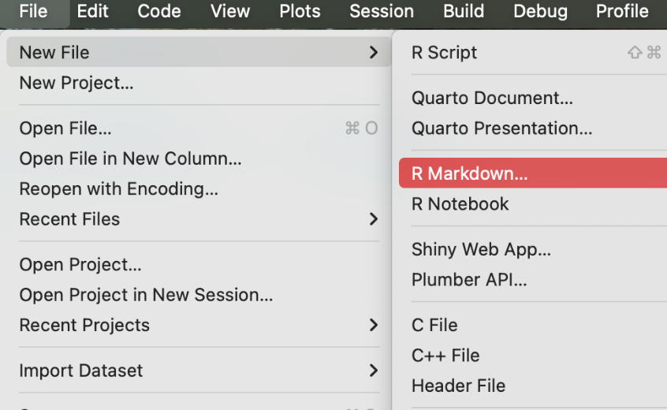
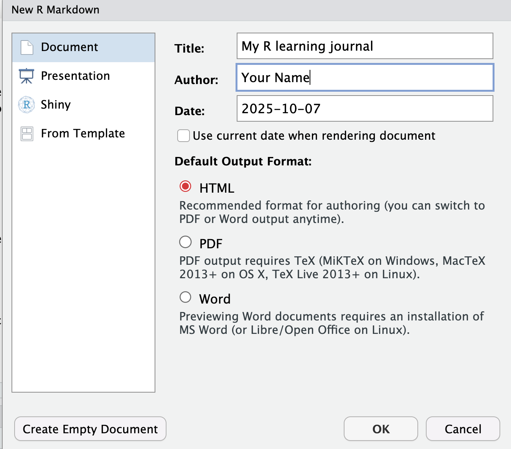
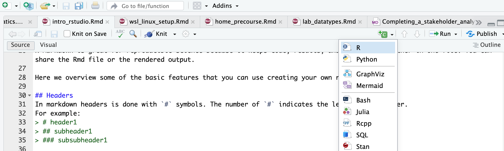
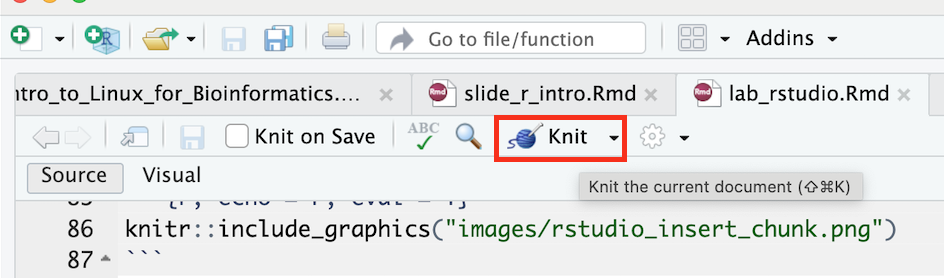

<br>

```{r,child="assets/header-lab.Rmd"}
```

<!-- ------------ Only edit title, subtitle & author above this ------------ -->

# Introduction

In this lab you will:

1. find your way around **RStudio**,
2. install and load your first **package**,
3. start an **R Markdown** document, your *R learning journal*, that you can keep adding to during the whole course.

R Markdown is a file format for making dynamic documents with R. It combines plain text with chunks of R code that are run when you *knit* (render) the document to HTML, PDF or Word. Because code, results and narrative live together in one file, R Markdown is a great tool for reproducible science: anyone with the `.Rmd` file can rebuild your report.

# Part 1: A quick tour of RStudio

## The four panes

When you open RStudio you will see four panes:

| Pane | What it is for |
|:-----|:---------------|
| **Source** (top left) | Writing scripts and R Markdown files. Your work is saved here. |
| **Console** (bottom left) | Where R actually runs code. Good for quick tests, but nothing is saved. |
| **Environment / History** (top right) | The objects (variables, data) you have created. |
| **Files / Plots / Packages / Help** (bottom right) | Your files, your plots, installed packages and help pages. |

**Try it:** type `2 + 2` in the Console and press Enter. Then type `?mean` and look at the Help pane.

## Console vs. script

Code typed in the Console is gone when you close RStudio. Code written in a script or R Markdown file is **saved** and can be re-run at any time. Use the Console for quick experiments, and files for anything you want to keep.

## Create an RStudio Project

A Project keeps all files for one piece of work in one folder and sets the working directory for you, so file paths just work.

1. **File → New Project… → New Directory → New Project**.
2. Name the directory `r-course` and choose where to save it.
3. Click **Create Project**.

Check where R is "looking" for files:

```{r getwd, eval=FALSE}
getwd()
```

The path should end with `r-course`.

# Part 2: Install and load a package

Install `ggplot2` (you only need to do this **once** per computer):

```{r install, eval=FALSE}
install.packages("ggplot2")
```

Load it (you need to do this **every** time you start R):

```{r load}
library(ggplot2)
```

If `library()` gives an error saying there is no package called `ggplot2`, the installation did not work. Ask a teacher!

# Part 3: Create an R Markdown file

In RStudio: **File → New File → R Markdown… → Document**. Set the title to "`My R learning journal`", choose **HTML**, click **OK**, and save the file as `learning_journal.Rmd` in your `r-course` project folder.





RStudio fills the new file with example content. Delete everything below the YAML header (the part between the two `---` lines) so you can start fresh.

# Anatomy of an R Markdown file

An `.Rmd` file has three kinds of content:

- **YAML header** (between `---`): controls output settings.
- **Markdown text**: headings, lists, links, images.
- **Code chunks**: R code (or bash, Python, etc.) that is run when you knit.

## YAML header

The YAML header sits between the `---` lines at the top of the file. It controls settings like title, author, date, output format and table of contents. For example:

```yaml
---
title: "My R learning journal"
author: "Your Name"
date: "`r knitr::inline_expr('Sys.Date()')`" # today's date, filled in when you knit
output:
  html_document:
    toc: true            # table of contents
    toc_depth: 3         # header levels shown in the toc
    number_sections: true # number the headers
---
```

Writing `date: "2026-11-02"` would fix the date forever. Using `` `r knitr::inline_expr('Sys.Date()')` `` asks R for today's date every time you knit.

## Markdown text

Markdown is a lightweight way to add structure to plain text. It is easy to learn and used in many places (GitHub, forums, note-taking apps).

### Headers

Headers are made with `#` symbols. The number of `#` sets the level:

```markdown
# Header 1
## Header 2
### Header 3
```

Leave a **blank line** before and after a header, otherwise it may be shown as plain text.

### Common formatting

```markdown
Bold text: **bold**
Italic text: *italic*
Inline code: `1 + 1`

Lists (leave a blank line before the list):

- item one
- item two

1. first
2. second

Links: [NBIS](https://nbis.se)

Images: 
```

## Code chunks

Insert an R chunk by clicking the green **+C** button and choosing **R**, or with the keyboard shortcut **Cmd + Option + I** (Mac) or **Ctrl + Alt + I** (Windows/Linux).



A chunk looks like this in your file:

````markdown
`r ''````{r}
1 + 1
```
````

and like this when knitted:

```{r one-plus-one}
1 + 1
```

Run a single chunk while you work by clicking the green ▶ in its top-right corner.

### Chunk options

Chunk options go inside the curly braces, e.g. `{r, echo=FALSE}`, and control how a chunk behaves:

| Option | Description | Example |
|:-------|:------------|:--------|
| `eval` | Whether to run the code | `eval = FALSE` |
| `echo` | Whether to show the code in the output | `echo = FALSE` |
| `include` | Whether to show anything (code *and* results) | `include = FALSE` |
| `fig.width` | Width of figures in inches | `fig.width = 7` |
| `fig.height` | Height of figures in inches | `fig.height = 5` |
| `message` | Whether to show messages | `message = FALSE` |
| `warning` | Whether to show warnings | `warning = FALSE` |
| `results` | How to show results: `markup` (default), `asis`, `hold`, `hide` | `results = 'hide'` |

For example, this chunk uses `eval=TRUE, echo=TRUE, message=FALSE, warning=FALSE`, so it shows the code and the results but hides messages and warnings:

```{r summary-cars, eval=TRUE, echo=TRUE, message=FALSE, warning=FALSE}
summary(cars) # summary statistics of the built-in cars dataset
```

## Inline code

You can put R results directly into a sentence. Writing

```markdown
The cars dataset has `r knitr::inline_expr('nrow(cars)')` rows.
```

gives: The cars dataset has `r nrow(cars)` rows.

If the data changes, the number in your text updates automatically when you re-knit.

# Part 4: Your learning journal

Now fill in `learning_journal.Rmd`. Add each section below as a header, write a few sentences, and add code chunks where asked. **Knit often** to check your work.

## About me

Write a few sentences about yourself and the project you are working on.

## What do I want to learn in this course?

Make a bulleted list:

- I would like to learn…
- …

## A simple calculation

Insert a chunk and write a calculation of your own, for example your age in days or the number of samples in your project. Use `eval=TRUE, echo=TRUE` so both the code and the result are shown.

## My first plot

Add this chunk and knit. Five lines of R give you a publication-style figure:

```{r first-plot, fig.width=7, fig.height=4}
ggplot(iris, aes(x = Petal.Length, y = Petal.Width, colour = Species)) +
  geom_point(size = 2.5, alpha = 0.8) +
  geom_smooth(method = "lm", se = FALSE) +
  labs(x = "Petal length (cm)", y = "Petal width (cm)") +
  theme_minimal(base_size = 14)
```

**Try it:** change `Petal.Length` to `Sepal.Length` and knit again. How long would that take to redo in Excel?

## Spot the bug

Copy this chunk into your journal and knit:

```{r spot-bug}
expr <- data.frame(
  sample = paste0("S", 1:6),
  group  = c("control", "control", "control", "treated", "treated", "treated"),
  value  = c(5.1, 4.8, NA, 7.9, 8.4, 8.1)
)

tapply(expr$value, expr$group, mean)
```

Why is the mean for `control` `NA`? One fix is to ignore missing values:

```{r spot-bug-fix}
tapply(expr$value, expr$group, mean, na.rm = TRUE)
```

In your journal, write one or two sentences: is it OK to simply drop the missing value? What would you report in a paper?

## Insert an image

Insert an image with Markdown syntax:

```markdown

```

or from a code chunk, which lets you control the size:

```{r include-image, eval=FALSE}
knitr::include_graphics("https://www.r-project.org/logo/Rlogo.png")
```

To use your own image instead, save it inside your project folder (e.g. in a subfolder `images/`) and use a path like `images/my_figure.png`. If the file does not exist, knitting will stop with an error.

## Optional: working with AI

Ask an AI assistant to write a chunk that, for example, calculates the mean `Petal.Length` for each `Species` in `iris`. Paste the code into your journal, then write down:

- Did it run?
- Is the result correct? How did you check?
- Was there anything in the code you did not understand?

## Session info

End your journal with this chunk. It records your R version and loaded packages, so others (and future you) know exactly what was used:

```{r session-info, eval=FALSE}
sessionInfo()
```

# Knit (render) to HTML

Click the **Knit** button. RStudio renders your file and opens the HTML report.



You can also render from the Console:

```{r render, eval=FALSE}
rmarkdown::render("learning_journal.Rmd")
```

# Command overview

| Command / action | What it does | Example |
|:-----------------|:-------------|:--------|
| File → New Project | Creates an RStudio Project | `r-course` |
| `install.packages()` | Installs a package (once) | `install.packages("ggplot2")` |
| `library()` | Loads a package (every session) | `library(ggplot2)` |
| File → New File → R Markdown | Creates a new Rmd template | `learning_journal.Rmd` |
| Markdown headings / lists | Structure your narrative | `## Project idea` |
| Code chunk | Runs R code reproducibly | ```` ```{r} ```` … ```` ``` ```` |
| Chunk options | Control chunk behaviour | `echo=FALSE`, `fig.width=7` |
| Inline R code | Puts R results in your text | `` `r knitr::inline_expr('2 + 2')` `` |
| `rmarkdown::render()` | Knits from the Console | `rmarkdown::render("learning_journal.Rmd")` |
| `sessionInfo()` | Records R and package versions | `sessionInfo()` |

# Quiz time!

Mini challenges to lock in what you learned. Hints are inline; click to reveal the answers.

**Q1.** If you press **Knit** but the file has never been saved, what happens?  
*Hint: what does Knit need to know about the file's location?*

<details>
<summary>Answer</summary>

RStudio asks you to save the file first. Knitting needs a file on disk to work out paths and to know where to write the output, which is saved in the same folder as the `.Rmd`.

</details>

**Q2.** Your knitted report shows `## Results` as plain text instead of a heading. Why?  
*Hint: look at the lines around it.*

<details>
<summary>Answer</summary>

Most likely there is no blank line before the heading (or no space after the `#` symbols). Markdown needs a blank line before a heading and a space between `#` and the text: `## Results`.

</details>

**Q3.** Your code chunk shows the code but no result. Why?  
*Hint: check the chunk options.*

<details>
<summary>Answer</summary>

The chunk probably has `eval = FALSE`, which shows the code without running it. Change it to `eval = TRUE` (or remove the option, since `TRUE` is the default). Also check that the chunk starts with ```` ```{r} ```` and is closed with ```` ``` ````; otherwise it is treated as plain text.

</details>

**Q4.** Your report knits, but the code is hidden and only the results are shown. Which chunk option causes this?

<details>
<summary>Answer</summary>

`echo = FALSE`. It runs the code and shows the results, but hides the code itself.

</details>

**Q5.** You run `library(ggplot2)` and get *"there is no package called 'ggplot2'"*. What do you do?

<details>
<summary>Answer</summary>

Install it first with `install.packages("ggplot2")`, then run `library(ggplot2)` again. Installing is needed once per computer; loading is needed in every session.

</details>