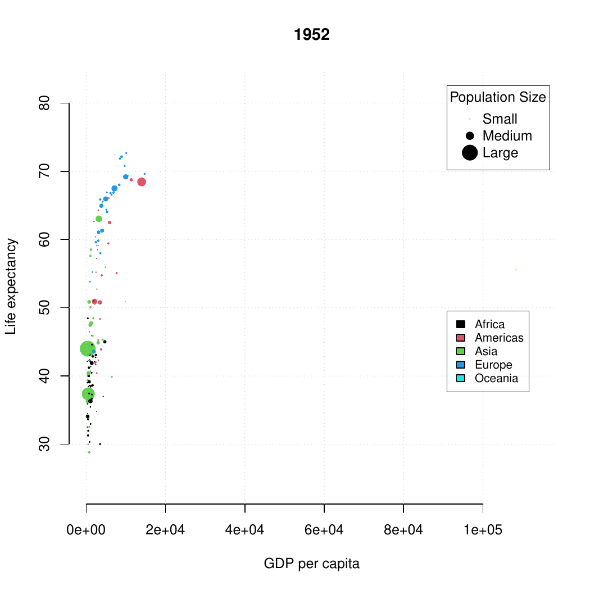

exclude: true
count: false

```{r,echo=FALSE,child="assets/header-slide.Rmd"}
```

<!-- ------------ Only edit title, subtitle & author above this ------------ -->

```{r setup, include=FALSE}
knitr::opts_chunk$set(echo = TRUE, width=60, fig.align = 'center')
```

```{r,echo=FALSE,message=FALSE,warning=FALSE}
# load the packages you need
#library(dplyr)
#library(tidyr)
#library(stringr)
#library(ggplot2)
#library(mkteachr)
#library(vcd)
```

---
name: ex2_graphics
# Example graphics
.pull-left-70[

]
---
name: graphical_devices
class: spaced

# Graphical devices

The concept of a **graphical device** is crucial for understanding R graphics.  

--
A device can be a screen (default) or a file.  

--

Creating a plot entails:  
* opening a graphical device (not necessary for plotting on screen),

--
* plotting to the graphical device,

--
* closing the graphical device (very important!)

--

# Common graphical devices

```{r device-type, echo = F, eval = T}
devices <- data.frame(
  `Device Type` = c("Screen", "Bitmap/Raster", "Vector", "Cairo"),
  `Functions` = c("default device", "png(), bmp(), tiff(), jpeg()", "svg(), pdf()", "cairo_pdf(), cairo_ps()"),
  `Notes` = c("Displays plot on screen", 
              "Use for images with pixel data", 
              "High-quality, scalable graphics", 
              "Enhanced quality, especially on Windows")
)
kable(devices, format = "html", escape = FALSE, align = "l")
```

For more information visit [this link](http://stat.ethz.ch/R-manual/R-devel/library/grDevices/html/Devices.html).

---
name: working_with_graphical_devs
class: spaced

# Working with graphical devices

```{r graphdevex, eval=FALSE, tidy=FALSE}
png(filename = 'myplot.png', width = 320, height = 320, antialias = T)
# anti-aliasing, a technique that smooths the edges of shapes and text in the plot, 
# making them appear less pixelated or jagged.
plot(x=c(1,2,7), y=c(2,3,5))
dev.off()
```

--

What we did was, in sequence:

* open a graphical device, here `png()` with some parameters,
* do the actual plotting to the device using `plot()` and
* close the graphical device using `dev.off()`.

--

> It is of paramount importance to remember to close graphical devices. Otherwise, our plots may end up in some random weird files or on screens.

---

name: plot_basics

# `base::plot()` basics

`base::plot()` is a basic command that lets you visualize your data and results. It is very powerful yet takes some effort to fully master it. Let's begin with plotting three points:

* A(1,2);
* B(2,3);
* C(7,5);

.size-40[
```{r plot1, eval=TRUE}
plot(x=c(1,2,7), y=c(2,3,5))
```
]

---
name: plot_data_frame

# Anatomy of a plot &mdash; episode 1

For convenience, we will create a data frame with our points:

.pull-left-50[
```{r plot1a, eval=TRUE, echo = F}
df <- data.frame(x=c(1,2,7), y=c(2,3,5),
row.names=c("A","B","C"))
df
```
]

.pull-right-50[
```{r, echo=TRUE}
plot(df)
```
]

---
name: plot_anatomy_2

# Anatomy of a plot &mdash; episode 2

.pull-left-50[
There are many parameters one can set in `plot()`. Let's have a closer look at some of them:
* `pch` &ndash; type of the plotting symbol
* `col` &ndash; color of the points
* `cex` &ndash; scale for points
* `main` &ndash; main title of the plot
* `sub` &ndash; subtitle of the plot
* `xlab` &ndash; X-axis label
* `ylab` &ndash; Y-axis label
* `las` &ndash; axis labels orientation
* `cex.axis` &ndash; axis lables scale
* `xlim` &ndash; X-axis limits or range   
* `ylim` &ndash; Y-axis limits or range  
]

.pull-right-50[
Let's make our plot a bit fancier...
```{r plot2, eval=TRUE}
# recycling rule in action!
plot(df, pch=c(15,17,19), 
     col=c("tomato", "slateblue"),
     main="Three points", sub="Stage 1")
```
]

---
name: layers_1

# Layers

Elements are added to a plot in the same order you plot them.
It is like layers in a graphical program. Think about it! For instance the auxiliary grid lines should be plotted before the actual data points.

.pull-left-50[
```{r gr.layers, eval=TRUE, tidy=TRUE, eval=FALSE}
# make an empty plot
plot(1:5, type='n', las=1, bty='n')
grid(col='grey', lty=3)
points(1:5, pch=19, cex=3)
abline(h = 3.0, col='red')
```
]
.pull-right-50[
```{r gr.layers.ex, eval=TRUE, tidy=TRUE, eval=TRUE, echo=FALSE}
plot(1:5, type='n', las=1, bty='n')
grid(col='grey', lty=3)
points(1:5, pch=19, cex=3)
abline(h = 3.0, col='red')
```
]
The line overlaps one data point. It is better to plot it before plotting `points()`

---
name: general_thoughts
class: spaced

# Some thoughts about plotting

There is a few points you should have in mind when working with plots:

--
* raster (png, jpeg, tiff) or vector graphics (svg, pdf, eps),

--
* colors, e.g. color-blind people, warm vs. cool colors and optical illusions (check [colorbrewer2.org](https://colorbrewer2.org/#type=sequential&scheme=BuGn&n=3)),

--
* avoid complications, e.g. 3D plots, pie charts etc.,

--
* use black and shades of grey for things you do not need to emphasize, i.e. basically everything except your main result,

--
* avoid 3 axes on one figure.  

???
Raster graphics are made of pixels (tiny colored squares). They are resolution-dependent — zooming in makes them blurry. Common formats: PNG, JPEG, TIFF.
Vector graphics are made of mathematical paths (lines, curves, shapes). They are resolution-independent — can be scaled without losing quality. Common formats: SVG, PDF, EPS.

A bonus note about tiff; tiff is a high-quality raster format — great for preserving detail, but still resolution-dependent (unlike vector graphics).

<!-- --------------------- Do not edit this and below --------------------- -->

---
name: end_slide
class: end-slide, middle
count: false

# Thank you! Questions?

```{r,echo=FALSE,child="assets/footer-slide.Rmd"}
```

```{r,include=FALSE,eval=FALSE}
# manually run this to render this document to HTML
#rmarkdown::render("presentation_demo.Rmd")
# manually run this to convert HTML to PDF
#pagedown::chrome_print("presentation_demo.html",output="presentation_demo.pdf")
```
