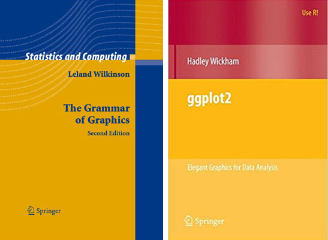
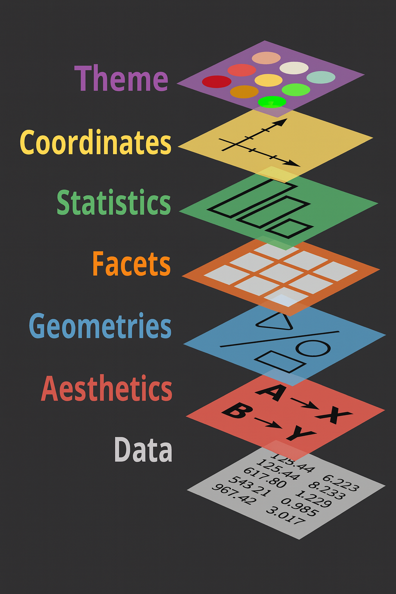
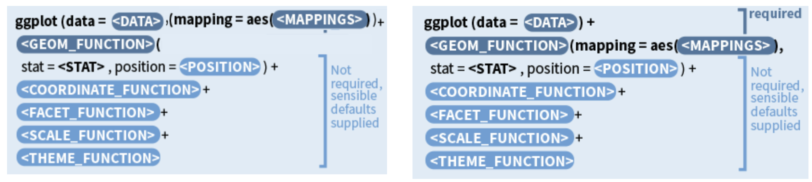
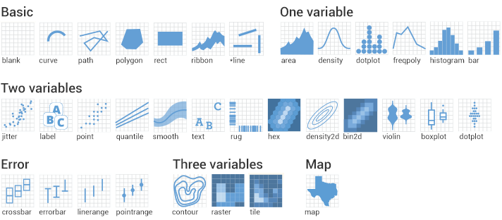

exclude: true
count: false

```{r,echo=FALSE,child="assets/header-slide.Rmd"}
```

<!-- ----------------- Only edit title & author above this ----------------- -->

```{r,echo=FALSE,message=FALSE,warning=FALSE}
# load packages
library(dplyr)
library(tidyr)
library(ggplot2)
library(patchwork)
library(tibble)
library(knitr)
library(kableExtra)

#colors
rv_col_dark <- "#125687"
rv_col_light <- "#e7eef3"

```
---

# Contents

* [Why `ggplot2`?](#intro)
* [Data](#data-format-1)
* [Grammar of Graphics](#gog)
* [Data](#data-iris)
* [Geoms](#geom)
* [Aesthetics](#aes)
* [Scales](#scales-discrete-colour)

---
name: intro
class: spaced

# Why `ggplot2`?

* Consistent code
* Flexible
* Automatic legends, colors etc
* Save plot objects
* Themes for reusing styles
* Numerous add-ons/extensions
* Nearly complete graphing solution

--

Not suitable for:

* 3D graphics

???

Why can't we just do everything is base plot? Of course, we could, but it's easier, consistent and more structured using `ggplot2`. There is bit of a learning curve, but once the code syntax and graphic building logic is clear, it becomes easy to plot a large variety of graphs.
---
name: gvb1

# Base Graphics vs `ggplot2`  

.pull-left-50[
```{r,fig.height=4.5,fig.width=4}
hist(iris$Sepal.Length)
```
]

--
.pull-right-50[
```{r,fig.height=4,fig.width=4}
library(ggplot2)
ggplot(data = iris,
       aes(x=Sepal.Length)) +
  geom_histogram(bins=8)
```
]

???

For simple graphs, the base plot seem to take minimal coding effort compared to a ggplot graph.
---
name: gvb2

# Base Graphics vs `ggplot2`  

.pull-left-50[
```{r,fig.height=4.5,fig.width=4}
# Plot
plot(x = iris$Petal.Length,
     y = iris$Petal.Width,
     col=c("red","green","blue")[iris$Species],
     pch=c(0,1,2)[iris$Species])
# Legend
legend(x=1,y=2.5,
       legend=c("setosa","versicolor","virginica"),
       pch=c(0,1,2),col=c("green","red","blue"))
```
--

**FIND THE ERROR!**   
]

--
.pull-right-50[
```{r,fig.height=4,fig.width=5}
ggplot(data = iris,
       aes(x = Petal.Length, 
           y = Petal.Width, 
           color=Species))+
  geom_point(
    aes(shape = Species))
```
]

???

For anything beyond extremely basic plots, base plotting quickly become complex. More importantly, base plots do not have consistency in it's functions or plotting strategy.
---

name: data-format-1

# Data • Format

--

- Wide format

```{r, echo=FALSE}
gc <- read.table("data/slide_ggplot2/counts_raw.txt", header = T, row.names = 1, sep = "\t")
kable(gc[c(1:6),c(1:4)]) %>%
  kable_styling(bootstrap_options = "striped", full_width = F) %>%
  row_spec(1:6, color = "orange") %>%
  column_spec(1, color = "red") %>%
  row_spec(0, bold = T, color = "blue")
```

--

* familiarity
* conveniency
* you see more data

---

name: data-format-2

# Data • Format

- Long format

--

```{r echo=FALSE}
md <- read.table("data/slide_ggplot2/metadata.csv", header = T, sep = ";")
samples <- colnames(gc[,c(1:4)])
gc[c(1:6),c(1:4)] %>%
  rownames_to_column(var = "Gene") %>%
  gather(Sample_ID, count, -Gene) %>%
  select(Sample_ID, everything()) %>%   
  head(6) %>%
  kable() %>%
  kable_styling("striped", full_width = F) %>%
  column_spec(1, color = "blue") %>%
  column_spec(2, color = "red")%>%
  column_spec(3, color = "orange")
```

--


```{r echo=FALSE}
md <- read.table("data/slide_ggplot2/metadata.csv", header = T, sep = ";")
samples <- colnames(gc[,c(1:4)])
gc[c(1:6),c(1:4)] %>%
  rownames_to_column(var = "Gene") %>%
  gather(Sample_ID, count, -Gene) %>% 
  full_join(md[c(1:4),], by = "Sample_ID") %>% 
  select(Sample_ID, everything()) %>% 
  select(-c(Gene,count), c(Gene,count)) %>%
  head(6) %>%
  kable() %>%
  kable_styling("striped", full_width = F) %>%
  column_spec(1:5, color = "blue") %>%
  column_spec(6, color = "red")%>%
  column_spec(7, color = "orange")
```

---

name: data-format-3

# Data • Format

- Long format

```{r echo=FALSE}
md <- read.table("data/slide_ggplot2/metadata.csv", header = T, sep = ";")
samples <- colnames(gc[,c(1:4)])
gc[c(1:6),c(1:4)] %>%
  rownames_to_column(var = "Gene") %>%
  gather(Sample_ID, count, -Gene) %>% 
  full_join(md[c(1:4),], by = "Sample_ID") %>% 
  select(Sample_ID, everything()) %>% 
  select(-c(Gene,count), c(Gene,count)) %>%
  head(6) %>%
  kable() %>%
  kable_styling("striped", full_width = F) %>%
  column_spec(1:5, color = "blue") %>%
  column_spec(6, color = "red")%>%
  column_spec(7, color = "orange")
```

--

* easier to add data to the existing
* Most databases store and maintain in long-formats due to its efficiency
* R tools **like ggplot** require data in long format.
* Functions available to change between data-formats
  * `melt()` from **reshape2**
  * `pivot_longer()` from **tidyverse**
  
---
name: data-iris

# Data • `iris`

* Input data is always an R `data.frame` object


```{r,echo=FALSE}
iris %>%
  head(n=3) %>%
  kable("html",escape=F,align="c")
```

```{r}
str(iris)
```

???

It's a good idea to use `str()` to check the input dataframe to make sure that numbers are actually numbers and not characters, for example. Verify that factors are correctly assigned.

---
name: gog
class: spaced

# Grammar Of Graphics

.pull-left-30[


]

--

.pull-right-70[
* **Data**: Input data
* **Aesthetic**: Visual characteristics of the geometry. Size, Color, Shape etc
* **Geom**: A geometry representing data. Points, Lines etc
* **Scale**: How visual characteristics are converted to display values
* **Statistics**: Statistical transformations. Counts, Means etc
* **Coordinates**: Numeric system to determine position of geometry. Cartesian, Polar etc
* **Facets**: Split data into subsets  

*recreated from Quebec Centre for Biodiversity Science*
]

???

`ggplot` was created by Hadley Wickham in 2005 as an implementation of Leland Wilkinson's book Grammar of Graphics.

Different graphs have always been considered as independent entities and also labelled differently such as barplots, scatterplots, boxplots etc. Each graph has it's own function and plotting strategy.

Grammar of graphics (GOG) tries to unify all graphs under a common umbrella. GOG brings the idea that graphs are made up of discrete components which can be mixed and matched to create any plot. This creates a consistent underlying framework to graphing.  

**Note:** 
aesthetic is sometimes also referred to as mappings and can be passed to main `ggplot()` or in individual geoms. But defining aesthetics in the main `ggplot()` call allows all subsequent layers to inherit these mappings automatically.  
---
name: syntax

# Building A Graph: Syntax



--

<div style="font-size:80%">

| **Component**             | **Purpose / Description**                                          |
|----------------------------|-------------------------------------------------------------------|
| `data`                    | Dataset used for plotting.                                        |
| `mapping` (inside `aes()`) | Defines aesthetic mappings (e.g., x, y, color).                  |
| `geom_function`            | Specifies geometric object (e.g., `geom_point`, `geom_boxplot`). |
| `stat`                     | Defines statistical transformation (e.g., `stat_bin`).           |
| `position`                 | Adjusts object placement (e.g., `position_dodge`).               |
| `coordinate_function`      | Sets coordinate system (e.g., `coord_flip`, `coord_polar`).      |
| `facet_function`           | Splits data into panels (e.g., `facet_wrap`, `facet_grid`).      |
| `scale_function`           | Controls axes and legend scaling (e.g., `scale_x_log10`).        |
| `theme_function`           | Adjusts visual style (e.g., `theme_bw`, `theme_minimal`).        |


---

name: build-1

# Building A Graph

.pull-left-40[
```{r,fig.height=3.5,fig.width=3.5,eval=FALSE}
ggplot(iris)
```
]

.pull-right-50[
```{r,fig.height=3.5,fig.width=3.5,echo=FALSE}
data(iris)
ggplot(iris)
```
]

---
name: build-2

# Building A Graph

.pull-left-40[
```{r,fig.height=3.5,fig.width=3.5,eval=FALSE}
ggplot(iris,aes(x=Sepal.Length,
                y=Sepal.Width))
```
]

.pull-right-60[
```{r,fig.height=3.5,fig.width=3.5,echo=FALSE}
ggplot(iris,aes(x=Sepal.Length,
                y=Sepal.Width))
```
]

---
name: build-3

# Building A Graph

.pull-left-40[
```{r,fig.height=3.5,fig.width=3.5,eval=FALSE}
ggplot(iris,aes(x=Sepal.Length,
                y=Sepal.Width))+
  geom_point()
```
]

.pull-right-80[
```{r,fig.height=3.5,fig.width=3.5,echo=FALSE}
ggplot(iris,aes(x=Sepal.Length,
                y=Sepal.Width))+
  geom_point()
```
]

---
name: build-4

# Building A Graph

.pull-left-40[
```{r,fig.height=3.5,fig.width=3.5,eval=FALSE}
ggplot(iris,aes(x=Sepal.Length,
                y=Sepal.Width,
                colour=Species))+
  geom_point()
```
]

.pull-right-60[
```{r,fig.height=3.5,fig.width=3.5,echo=FALSE}
ggplot(iris,aes(x=Sepal.Length,
                y=Sepal.Width,
                colour=Species))+
  geom_point()
```
]

---
name: geom

# Geoms


```{r, eval=FALSE}
help.search("^geom_",package="ggplot2")
```

???

Geoms are the geometric components of a graph such as points, lines etc used to represent data. The same data can be visually represented in different geoms. For example, points or bars. Mandatory input requirements change depending on geoms.
---
name: geom1

# Geoms
```{r,eval=TRUE}
p <- ggplot(iris)
```
---
name: geom2

# Geoms
```{r}
p <- ggplot(iris)
# scatterplot
p+geom_point(aes(x=Sepal.Length,y=Sepal.Width))
```
---
name: geom3

# Geoms
```{r}
p <- ggplot(iris)
# barplot
p+geom_bar(aes(x=Sepal.Length))
```
---
name: geom4

# Geoms
```{r}
p <- ggplot(iris)
# boxplot
p+geom_boxplot(aes(x=Species,y=Sepal.Width))
```

---
name: aes

# Aesthetics

* Mapped vs Fixed Aesthetics  

.pull-left-50[
```{r,fig.height=4,fig.width=5.5}
ggplot(iris)+
  geom_point(aes(x=Sepal.Length,
                 y=Sepal.Width,
                 size=Petal.Length,
                 alpha=Petal.Width,
                 shape=Species,
                 color=Species))
```
]

.pull-left-50[
```{r,fig.height=4,fig.width=4}
ggplot(iris)+
  geom_point(aes(x=Sepal.Length,
                 y=Sepal.Width),
                 size=2,
                 alpha=0.8,
                 shape=15,
                 color="steelblue")
```
]

???

Aesthetics are used to assign values to geometries. For example, a set of points can be a fixed size or can be different colors or sizes denoting a variable.

This would be an incorrect way to do it.

```
ggplot(iris)+
geom_point(aes(x=Sepal.Length,y=Sepal.Width,size=2)
```

---
name: aes-2

# Aesthetics

```{r,echo=TRUE,fig.height=4,fig.width=8}
x1 <- ggplot(iris) +
  geom_point(aes(x=Sepal.Length,
                 y=Sepal.Width))+
  stat_smooth(aes(x=Sepal.Length,
                  y=Sepal.Width))

x2 <- ggplot(iris,aes(x=Sepal.Length,
                      y=Sepal.Width))+
                      geom_point() + geom_smooth(level = 0.5)

x1|x2
```

???

If the same aesthetics are used in multiple geoms, they can be moved to `ggplot()`.

---
name: multiple-geom

# Multiple Geoms

```{r,fig.height=4.8,fig.width=9}
ggplot(iris,aes(x=Sepal.Length,y=Sepal.Width))+
      geom_point()+
      geom_line()+
      geom_smooth()+
      geom_rug()+
      geom_step()+
      geom_text(data=subset(iris,iris$Species=="setosa"),aes(label=Species))
```

???

Multiple geoms can be plotted one after the other. The order in which items are specified in the command dictates the plotting order on the actual plot.

In this case, the points appear over the lines.

```
ggplot(iris,aes(x=Sepal.Length,y=Sepal.Width))+
      geom_point()+
      geom_line()+
```

while here the lines appear above the points.

```
ggplot(iris,aes(x=Sepal.Length,y=Sepal.Width))+
      geom_line()+
      geom_point()+
```

Each geom takes input from `ggplot()` inputs. If extra input is required to a geom, it can be specified additionally inside `aes()`.

`data` can be changed if needed for specific geoms.

---
name: scales-overview
# Scales • Overview
* Control mapping of data to aesthetics  
* Scales: position, color, fill, size, shape, alpha, linetype  
* syntax:  
**`scale_<aesthetic>_<type>`**   

<div style="font-size:80%">

| **Aesthetic (What it controls)** | **Scale Type (How values are mapped)**                         | **Common Function Examples**                                                  | **When / Why to Use**                                                                                  |
| -------------------------------- | -------------------------------------------------------------- | ----------------------------------------------------------------------------- | ------------------------------------------------------------------------------------------------------ |
| 🎨 **Color / Fill**              | `continuous`, `discrete`, `manual`, `identity`                 |`scale_color_continuous()`<br>`scale_fill_manual()`<br>`scale_color_brewer()` | To control color mapping — e.g. use `manual` for custom palettes or `brewer` for ready-made color sets |
| ⚪ **Size**                       | `continuous`, `discrete`, `manual`                             | `scale_size_continuous()`<br>`scale_size_manual()`                            | Adjust how numeric or categorical values affect point sizes                                            |
| 🔷 **Shape**                     | `discrete`, `manual`                                           | `scale_shape_discrete()`<br>`scale_shape_manual()`                            | Map categories to different point shapes                                                               |
| ➖ **Linetype**                   | `identity`, `manual`, `discrete`                               | `scale_linetype_manual()`                                                     | Customize line styles for groups in line plots                                                         |
| 📊 **X / Y axes**                | `continuous`, `discrete`, `log`, `reverse`, `date`, `datetime` | `scale_x_log10()`<br>`scale_y_reverse()`<br>`scale_x_date()`                  | Transform axis scales (e.g. log scale, reverse direction, or show dates)                               |


---
name: scales-discrete-color

# Scales • Discrete Colors

* scales: position, color, fill, size, shape, alpha, linetype
* syntax:  
**`scale_<aesthetic>_<type>`** <br>

```{r, eval = F}
p + scale_fill_manual(
  name = "My legend",                     # legend title
  labels=c("Min","Max"),                 # legend labels
  breaks = c(min(data$x), max(data$x)),  # legend breaks
  values = c("skyblue", "navy"),         # colors to use

)
```

--

.pull-left-50[
```{r,fig.height=2.7,fig.width=4}
p <- ggplot(iris)+
  geom_point(aes(x=Sepal.Length,
                 y=Sepal.Width,
                 color=Species))
p
```
]

--

.pull-right-50[
```{r,fig.height=2.7,fig.width=4}
p <- p + scale_color_manual(
     name="Manual",
     values=
       c("#5BC0EB","#FDE74C","#9BC53D"))
p
```
]

???

Scales are used to control the aesthetics. For example the aesthetic color is mapped to a variable `x`. The palette of colors used, the mapping of which color to which value, the upper and lower limit of the data and colors etc is controlled by scales.

---
name: scales-continuous-color

# Scales • Continuous Colors

* In RStudio, type `scale_`, then press **TAB**

--

.pull-left-50[
```{r,fig.height=4,fig.width=5}
p <- ggplot(iris)+
      geom_point(aes(x=Sepal.Length,
                     y=Sepal.Width,
      shape=Species,
      color=Petal.Length))
p
```
]

--

.pull-right-50[
```{r,fig.height=4,fig.width=5}
#
p +
scale_color_gradient(name="Pet Len",
  breaks=range(iris$Petal.Length),
  labels=c("Min","Max"),
  low="black",high="red")

```
]

???

Continuous colours can be changed using `scale_color_gradient()` for two colour gradient. Any number of breaks and colours can be specified using `scale_color_gradientn()`.  

---
name: scales-shape

# Scales • Shape

.pull-left-50[
```{r,fig.height=4,fig.width=5}
p <- ggplot(iris)+
      geom_point(aes(x=Sepal.Length,
                     y=Sepal.Width,
      shape=Species,
      color=Species))
p
```
]

--

.pull-right-50[
```{r,fig.height=4,fig.width=5}
#
p +
scale_color_manual(name="New",
   values=c("blue","green","red"))+
scale_shape_manual(name="Bla",
                   values=c(0,1,2))
```
]

???

Shape scale can be adjusted using `scale_shape_manual()`. Multiple mappings for the same variable groups legends.

---
name: scales-axis

# Scales • Axes

* scales: x, y
* syntax: `scale_<axis>_<type>`
* arguments: name, limits, breaks, labels

--

.pull-left-50[
```{r,fig.height=4,fig.width=5}
p <- ggplot(iris)+
      geom_point(aes(x=Sepal.Length,
                     y=Sepal.Width))
p
```
]

--

.pull-right-50[
```{r,fig.height=4,fig.width=5}
p + scale_color_manual(name="New",
   values=c("blue","green","red"))+
scale_x_continuous(name="Sepal Length",
        breaks=seq(1,8),limits=c(3,5))
```
]

???

The x and y axes are also controlled by scales. The axis break points, the break point text and limits are controlled through scales.

When setting limits using `scale_`, the data outside the limits are dropped. Limits can also be set using `lims(x=c(3.5))` or `xlim(c(3,5))`. When mapping, `coord_map()` or `coord_cartesian()` is recommended for setting limits. 
---
name: extension
class: spaced


# Extensions

* [**gridExtra**](https://cran.r-project.org/web/packages/gridExtra/index.html): Extends grid graphics functionality
* [**ggpubr**](http://www.sthda.com/english/rpkgs/ggpubr/): Useful functions to prepare plots for publication  
* [**cowplot**](https://cran.r-project.org/web/packages/cowplot/vignettes/introduction.html): Combining plots  
* [**ggthemes**](https://cran.r-project.org/web/packages/ggthemes/vignettes/ggthemes.html): Set of extra themes  
* [**ggthemr**](https://github.com/cttobin/ggthemr): More themes  
* [**ggsci**](https://cran.r-project.org/web/packages/ggsci/vignettes/ggsci.html): Color palettes for scales  
* [**ggrepel**](https://cran.r-project.org/web/packages/ggrepel/vignettes/ggrepel.html): Advanced text labels including overlap control  
* [**ggmap**](https://github.com/dkahle/ggmap): Dedicated to mapping  
* [**ggraph**](https://github.com/thomasp85/ggraph): Network graphs  
* [**ggiraph**](http://davidgohel.github.io/ggiraph/): Converting ggplot2 to interactive graphics  


* [**Shortlisted ggplot2 extension by category**](https://mtbioinformatics.wordpress.com/blog-2/)  
* [**Offical ggplot2 extensions**](https://ggplot2.tidyverse.org/extensions/)  
---
name: help
class: spaced

# Help

* [**ggplot2 official reference**](http://ggplot2.tidyverse.org/reference/)  
* [**The R cookbook**](http://www.cookbook-r.com/)  
* [**StackOverflow**](https://stackoverflow.com/)  
* [**RStudio Cheatsheet**](https://www.rstudio.com/resources/cheatsheets/)  
* [**r-statistics Cheatsheet**](http://r-statistics.co/ggplot2-cheatsheet.html)  
* [**ggplot2 GUI**](https://site.shinyserver.dck.gmw.rug.nl/ggplotgui/)  
* Numerous personal blogs, r-bloggers.com etc.  


<!-- --------------------- Do not edit this and below --------------------- -->

---
name: end-slide
class: end-slide, middle
count: false

# Thank you. Questions?

```{r,echo=FALSE,child="assets/footer-slide.Rmd"}
```

```{r,include=FALSE,eval=FALSE}
# manually run this to render this document to HTML
rmarkdown::render("ggplot_presentation.Rmd")
# manually run this to convert HTML to PDF
#pagedown::chrome_print("ggplot_presentation.html",output="ggplot_presentation.pdf")
```
