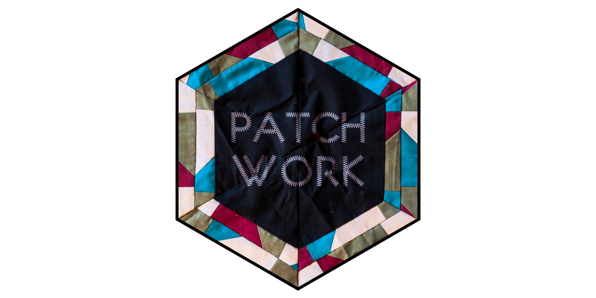
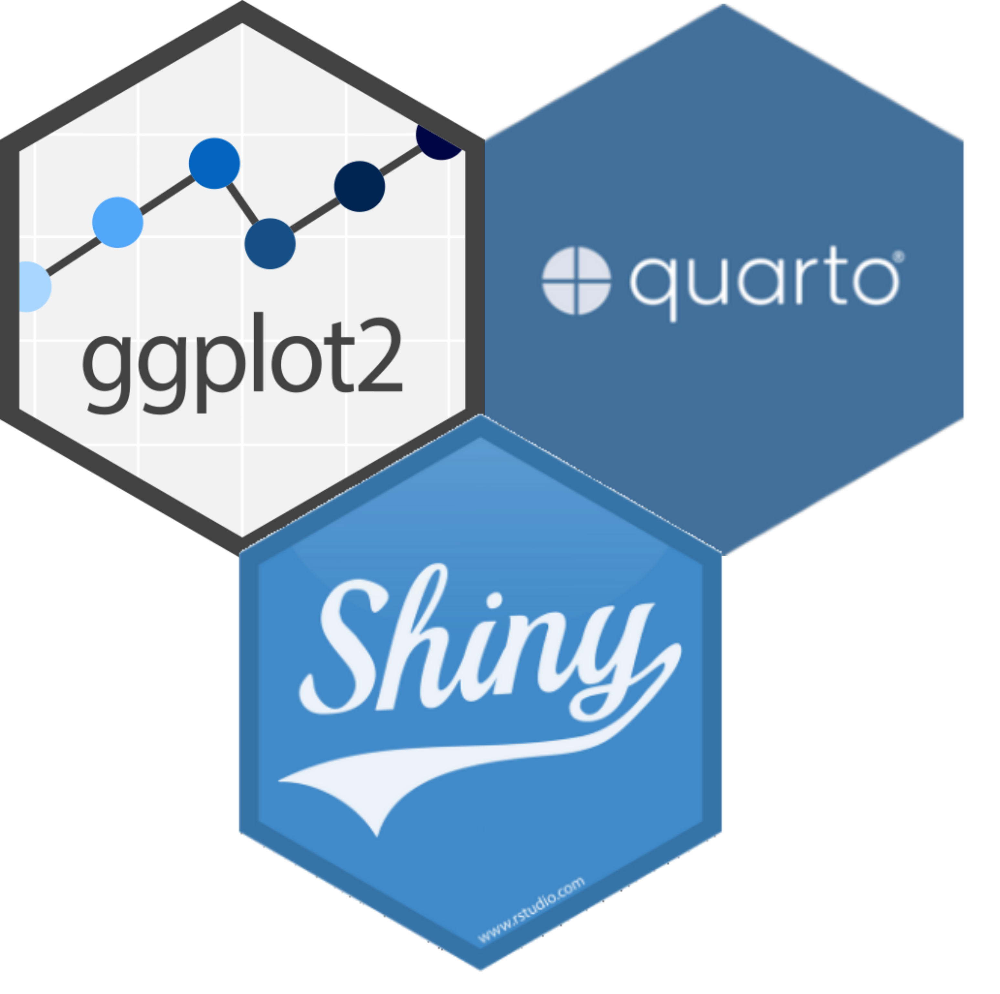

exclude: true
count: false

```{r,echo=FALSE,child="assets/header-slide.Rmd"}
```

<!-- ----------------- Only edit title & author above this ----------------- -->

```{r,echo=FALSE,message=FALSE,warning=FALSE}
# load packages
library(dplyr)
library(tidyr)
library(ggplot2)
library(patchwork)
library(tibble)
library(knitr)
library(kableExtra)

#colors
rv_col_dark <- "#125687"
rv_col_light <- "#e7eef3"

```
---

# Contents

* [Facets](#facet-wrap)
* [Coordinates](#coordinate)
* [Theme](#theme)
* [Position](#position)
* [Stat](#stat)
* [Saving Plots](#save)
* [Combining Plots](#comb)
* [Interactive Plots](#interactive)
* [Extensions](#extension)

---
name: facet-wrap

# Facets • `facet_wrap`

* Split to subplots based on variable(s)
* Facetting in one dimension

--

.pull-left-50[
```{r,fig.height=4.5,fig.width=5}
p <- ggplot(iris)+
      geom_point(aes(x=Sepal.Length,
                     y=Sepal.Width,
                     color=Species))
p
```
]

--

.pull-right-50[
```{r,fig.height=2.2,fig.width=4.5}
p + facet_wrap(~Species)
```

```{r,fig.height=2.4,fig.width=4.5}
p + facet_wrap(~Species,nrow=3)
```
]

???

`facet_wrap` is used to split a plot into subplots based on the categories in one or more variables.

---
name: facet-grid

# Facets • `facet_grid`

* Facetting in two dimensions

.pull-left-50[
```{r,fig.height=3.5,fig.width=5}
p <- diamonds %>%
     ggplot(aes(carat,price))+
     geom_point()
p + facet_grid(~cut+clarity)
```
]

--

.pull-left-50[
```{r,fig.height=4.2,fig.width=5.2}
p + facet_grid(cut~clarity)
```
]

???

`facet_grid` is also used to split a plot into subplots based on the categories in one or more variables. `facet_grid` can be used to create a matrix-like grid of two variables.

---
name: coordinate

# Coordinate Systems

| **Function**        | **What it does**                                    | **Common use / Example**                                  |
| ------------------- | --------------------------------------------------- | --------------------------------------------------------- |
| `coord_cartesian()` | Adjusts the visible region without removing data    | `coord_cartesian(xlim = c(2, 8))` → zoom into x-range 2–8 |
| `coord_fixed()`     | Keeps equal aspect ratio for x and y                | Useful for maps or shapes where scale should be equal     |
| `coord_flip()`      | Swaps x and y axes                                  | Great for horizontal bar plots                            |
| `coord_trans()`     | Transforms axes (e.g., log, sqrt)                   | `coord_trans(y = "log10")`                                |
| `coord_polar()`     | Converts to polar coordinates                       | Create pie charts or circular plots                       |
| `coord_map()`       | Uses map projection (scales adjusted for geography) | Plot geographic data with correct proportions             |
---
name: coordinate-polar

# Coordinate Systems • Polar
.pull-left-50[
```{r,fig.height=3.4,fig.width=4}
p <- ggplot(iris,aes(x="",y=Petal.Length,fill=Species))+
  geom_bar(stat="identity") 
p
```

]

--

.pull-right-50[
```{r,fig.height=3.9,fig.width=4.4}
p+coord_polar("y",start=0)
```
]

???

The coordinate system defines the surface used to represent numbers. Most plots use the cartesian coordinate sytem. Pie charts for example, is a polar coordinate projection of a cartesian barplot. Maps for example can have numerous coordinate systems called map projections. For example; UTM coordinates.
 
<div font-size = '80%'> 

| **Stat name** | **Used with**                     | **What it does**                         |
| ------------- | --------------------------------- | ---------------------------------------- |
| `"count"`     | `geom_bar()`                      | Counts rows per x value                  |
| `"identity"`  | any geom                          | Plots given y-values directly            |
| `"summary"`   | `geom_bar()`, `geom_pointrange()` | Computes summaries like mean, median     |
| `"bin"`       | `geom_histogram()`                | Groups numeric data into bins            |
| `"density"`   | `geom_density()`                  | Computes kernel density estimate         |
| `"smooth"`    | `geom_smooth()`                   | Fits a smoothing line (e.g., regression) |

---
name: theme

# Theme

* Modify non-data plot elements/appearance
* Axis labels, panel colors, legend appearance etc
* Save a particular appearance for reuse
* `?theme`
* Two build-in themes: `theme_grey()`, `theme_bw()`  

--

.pull-left-50[
```{r,fig.height=4,fig.width=4}
ggplot(iris,aes(Petal.Length))+
  geom_histogram()+
  facet_wrap(~Species,nrow=2)+
  theme_grey()
```
]

--

.pull-right-50[
```{r,fig.height=4,fig.width=4}
ggplot(iris,aes(Petal.Length))+
  geom_histogram()+
  facet_wrap(~Species,nrow=2)+
  theme_bw()
```
]

???

Themes allow to modify all non-data related components of the plot. This is the visual appearance of the plot. Examples include the axes line thickness, the background color or font family.

---
name: theme-legend

# Theme • Legend

```{r,fig.height=3,fig.width=4}
p <- ggplot(iris)+
      geom_point(aes(x=Sepal.Length,
                     y=Sepal.Width,
                     color=Species))
```

.pull-left-50[
```{r,fig.height=4.3,fig.width=4.3}
p + theme(legend.position="top")
```
]

.pull-right-50[
```{r,fig.height=4.3,fig.width=4.3}
p + theme(legend.position="bottom")
```
]

---
name: theme-title

# Theme • Title
Default location of title is left aligned. But you can centre it or right align it by `theme`. 
`hjust`, horizontal justification, value ranges from 0 (left) to 1 (right). 
```{r, out.width="45%"}
p <- ggplot(iris)+
      geom_point(aes(x=Sepal.Length, y=Sepal.Width, color=Species))+
      labs(title="My Title",subtitle="My Subtitle")
p + theme(plot.title=element_text(hjust=0.5),
          plot.subtitle=element_text(hjust=1.0))
```

---
name: theme-text

# Theme • Text

```{r,eval=FALSE}
element_text(family=NULL,face=NULL,color=NULL,size=NULL,hjust=NULL,
             vjust=NULL, angle=NULL,lineheight=NULL,margin = NULL)
```

```{r,echo=FALSE}
p <- diamonds %>%
      filter(cut=="Fair"|cut=="Good",color=="D"|color=="E") %>%
      droplevels() %>%
      ggplot(aes(carat,price,alpha=color,shape=cut))+
            geom_point()+
            labs(title="Title",subtitle="subtitle")+
            facet_grid(cut~color)
```

```{r}
p <- p + theme(
    axis.title=element_text(color="#e41a1c"),
    axis.text=element_text(color="#377eb8"),
    plot.title=element_text(color="#4daf4a"),
    plot.subtitle=element_text(color="#984ea3"),
    legend.text=element_text(color="#ff7f00"),
    legend.title=element_text(color="#ffff33"),
    strip.text=element_text(color="#a65628")
)
```

```{r,fig.height=4,fig.width=10,echo=FALSE}
dfr <- data.frame(value=rep(1,7),label=c("axis.title","axis.text","plot.title","plot.subtitle","legend.text","legend.title","strip.text"),stringsAsFactors=FALSE) %>%
  mutate(label=factor(label,levels=c("axis.title","axis.text","plot.title","plot.subtitle","legend.text","legend.title","strip.text")))

q <- ggplot(dfr,aes(x=label,y=value,fill=label))+
  geom_bar(stat="identity")+
  labs(x="",y="")+
  coord_flip()+
  scale_fill_manual(values=c("#e41a1c","#377eb8","#4daf4a","#984ea3","#ff7f00","#ffff33","#a65628"))+
  theme_minimal(base_size=20)+
  theme(
    legend.position="none",
    axis.text.x=element_blank(),
    axis.ticks=element_blank(),
    panel.grid=element_blank())

p|q
```

---
name: theme-rect

# Theme • Rect

```{r,eval=FALSE}
element_rect(fill=NULL,color=NULL,size=NULL,linetype=NULL)
```

```{r,echo=FALSE}
p <- diamonds %>%
      filter(cut=="Fair"|cut=="Good",color=="D"|color=="E") %>%
      droplevels() %>%
      ggplot(aes(carat,price,alpha=color,shape=cut))+
            geom_point()+
            labs(title="Title",subtitle="subtitle")+
            facet_grid(cut~color)
```

```{r}
p <- p + theme(
    plot.background=element_rect(fill="#b3e2cd"),
    panel.background=element_rect(fill="#fdcdac"),
    panel.border=element_rect(fill=NA,color="#cbd5e8",size=3),
    legend.background=element_rect(fill="#f4cae4"),
    legend.box.background=element_rect(fill="#e6f5c9"),
    strip.background=element_rect(fill="#fff2ae")
)
```

```{r,fig.height=3.8,fig.width=10,echo=FALSE}
dfr <- data.frame(value=rep(1,6),label=c("plot.background","panel.background","panel.border","legend.background","legend.box.background","strip.background"),stringsAsFactors=FALSE) %>%
  mutate(label=factor(label,levels=c("plot.background","panel.background","panel.border","legend.background","legend.box.background","strip.background")))

q <- ggplot(dfr,aes(x=label,y=value,fill=label))+
  geom_bar(stat="identity")+
  labs(x="",y="")+
  coord_flip()+
  scale_fill_manual(values=c("#b3e2cd","#fdcdac","#cbd5e8","#f4cae4","#e6f5c9","#fff2ae"))+
  theme_minimal(base_size=20)+
  theme(
    legend.position="none",
    axis.text.x=element_blank(),
    axis.ticks=element_blank(),
    panel.grid=element_blank())

p|q
```

---
name: theme-save

# Theme • Reuse

```{r,echo=FALSE}
p <- diamonds %>%
      filter(cut=="Fair"|cut=="Good"|cut=="Very Good") %>%
      droplevels() %>%
      ggplot(aes(carat,price,color=cut))+
            geom_point()
```

```{r,echo=TRUE}
newtheme <- theme_bw() + theme(
  axis.ticks=element_blank(),
  panel.background=element_rect(fill="white"),
  panel.grid.minor=element_blank(),
  panel.grid.major.x=element_blank(),
  panel.grid.major.y=element_line(size=0.3,color="grey90"),
  panel.border=element_blank(),
  legend.position="top",
  legend.justification="right"
)
```

.pull-left-50[
```{r,echo=TRUE,fig.height=3.5,fig.width=5}
p
```
]

.pull-right-50[
```{r,fig.height=3.3,fig.width=4.5}
p + newtheme
```
]

---
name: position

# Position

```{r,echo=FALSE}
USArrests %>% head(n=3)
```

```{r}
us <- USArrests %>% mutate(state=rownames(.)) %>% slice(1:4) %>%
      pivot_longer(c('Murder', 'Assault', 'UrbanPop', 'Rape'), 
                   names_to = 'type', 
                   values_to = 'value')
p <- ggplot(us,aes(x=state,y=value,fill=type))
```

--

.pull-left-50[
```{r,fig.height=3.3,fig.width=4.5}
p + geom_bar(stat="identity",position="stack")
```
]

--

.pull-right-50[
```{r,fig.height=3.3,fig.width=4.5}
p + geom_bar(stat="identity",position="dodge")
```
]

???
| **Position**          | **Description**                            | **Typical Use**                                       |
| --------------------- | ------------------------------------------ | ----------------------------------------------------- |
| `"stack"` *(default)* | Stacks bars on top of each other           | Show totals and part-to-whole relationships           |
| `"dodge"`             | Places bars side-by-side                   | Compare groups within the same category               |
| `"fill"`              | Stacks bars to equal height (100%)         | Show proportions within each category                 |


---
name: save

---
name: stat
# Stat 
```{r, fig.align='center', fig.height=3,fig.width=9}
x <- ggplot(iris) + geom_bar(aes(x=Sepal.Length),stat="bin")
y <- ggplot(iris) + geom_bar(aes(x=Species),stat="count")
z <- ggplot(iris) + geom_bar(aes(x=Species, y = Sepal.Length),stat="identity")
x|y|z
```

--
.pull-left-30[
```{r, out.width="100%", echo = F}

```
]
.pull-right-70[
- Uses simple operators `(|, /)` to combine ggplots.  
- Allows flexible side-by-side or stacked layouts.  
]
---
name: save
# Saving plots

```{r,eval=FALSE}
p <- ggplot(iris,aes(Petal.Length,Sepal.Length,color=Species))+
  geom_point()
```

* `ggplot2` plots can be saved just like base plots  

```{r,eval=FALSE}
png("plot.png",height=5,width=7,units="cm",res=200)
print(p)
dev.off()
```

* `ggplot2` package offers a convenient function  

```{r,eval=FALSE}
ggsave("plot.png",p,height=5,width=7,units="cm",dpi=200,type="cairo")
```

* Use `type="cairo"` for nicer anti-aliasing  
* Note that default units in `png` is pixels while in `ggsave` it's inches  
---
name: extension
class: spaced


# Extensions

* [**gridExtra**](https://cran.r-project.org/web/packages/gridExtra/index.html): Extends grid graphics functionality
* [**ggpubr**](http://www.sthda.com/english/rpkgs/ggpubr/): Useful functions to prepare plots for publication  
* [**cowplot**](https://cran.r-project.org/web/packages/cowplot/vignettes/introduction.html): Combining plots  
* [**ggthemes**](https://cran.r-project.org/web/packages/ggthemes/vignettes/ggthemes.html): Set of extra themes  
* [**ggthemr**](https://github.com/cttobin/ggthemr): More themes  
* [**ggsci**](https://cran.r-project.org/web/packages/ggsci/vignettes/ggsci.html): Color palettes for scales  
* [**ggrepel**](https://cran.r-project.org/web/packages/ggrepel/vignettes/ggrepel.html): Advanced text labels including overlap control  
* [**ggmap**](https://github.com/dkahle/ggmap): Dedicated to mapping  
* [**ggraph**](https://github.com/thomasp85/ggraph): Network graphs  
* [**ggiraph**](http://davidgohel.github.io/ggiraph/): Converting ggplot2 to interactive graphics  


* [**Shortlisted ggplot2 extension by category**](https://mtbioinformatics.wordpress.com/blog-2/)  
* [**Offical ggplot2 extensions**](https://ggplot2.tidyverse.org/extensions/)  
---
name: help
class: spaced

# Help

* [**ggplot2 official reference**](http://ggplot2.tidyverse.org/reference/)  
* [**The R cookbook**](http://www.cookbook-r.com/)  
* [**StackOverflow**](https://stackoverflow.com/)  
* [**RStudio Cheatsheet**](https://www.rstudio.com/resources/cheatsheets/)  
* [**r-statistics Cheatsheet**](http://r-statistics.co/ggplot2-cheatsheet.html)  
* [**ggplot2 GUI**](https://site.shinyserver.dck.gmw.rug.nl/ggplotgui/)  
* Numerous personal blogs, r-bloggers.com etc.  
---
name: data-viz-course
class: spaced

# Advanced Data Visualisation Workshop

.vcenter[
.pull-left-50[

```{r, out.width="100%", echo = F}

```
]

.pull-right-50[
- [**Course page**](https://nbisweden.github.io/workshop-data-visualization-r/2704/)
- Duration: 3-day NBIS workshop
- Scheduled for **April 27-29, 2027**
- Location: **Lund/Umeå and Tartu(Estonia)**
]
]
--

.hcenter[
**Applications will be open soon in December.**
]

<!-- --------------------- Do not edit this and below --------------------- -->

---
name: end-slide
class: end-slide, middle
count: false

# Thank you. Questions?

```{r,echo=FALSE,child="assets/footer-slide.Rmd"}
```

```{r,include=FALSE,eval=FALSE}
# manually run this to render this document to HTML
rmarkdown::render("ggplot_presentation.Rmd")
# manually run this to convert HTML to PDF
#pagedown::chrome_print("ggplot_presentation.html",output="ggplot_presentation.pdf")
```
