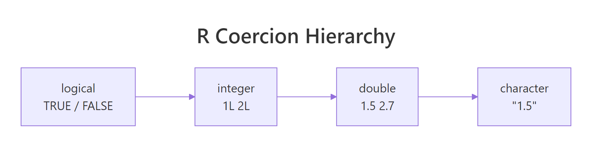

exclude: true
count: false

```{r,echo=FALSE,child="assets/header-slide.Rmd"}
```

<!-- ------------ Only edit title, subtitle & author above this ------------ -->

```{r setup, include=FALSE}
knitr::opts_chunk$set(echo=TRUE, width=60)
```

```{r,include=FALSE}
# load the packages you need
#library(dplyr)
#library(tidyr)
#library(stringr)
#library(ggplot2)
#library(mkteachr)
```

---
name: intro

# Today 🧱

The **building blocks** of every R script:

1. **Variables** &mdash; giving names to values
2. **Data types** &mdash; numbers, text and `TRUE`/`FALSE`
3. **Converting types** &mdash; on purpose, and by accident
4. **Special values** &mdash; `Inf`, `NaN`, `NA`
5. **Operators** &mdash; calculating and comparing

<br>

.content-box-green[
Throughout, we'll use small examples from the lab: sample IDs, gene names, Ct values, read counts and p-values.
]

---
name: variables

# Variables

A **variable** stores a value under a name, using the *assignment operator* `<-`:

```{r variables}
sample_id <- "S01"
gene <- "BRCA1"
read_count <- 1523
read_count
```

--

Once stored, you can reuse and combine values:

```{r variables2}
total_reads <- 2000
read_count / total_reads * 100   # % of reads mapped to BRCA1
```

--

.content-box-yellow[
**Use `<-` to assign** and keep `=` for function arguments, e.g. `round(x, digits = 2)`.  
**Shortcut:** **Alt + -** (Windows/Linux) or **Option + -** (Mac).
]

---
name: variables_naming

# Naming variables

A valid name contains letters, numbers, `.` and `_`, and starts with a letter.

| Name | Valid? |
|:-----|:-------|
| `ct_value`, `sample2`, `brca1_expr` | ✅ |
| `2samples` | ❌ starts with a number |
| `gene-count` | ❌ `-` means minus |
| `if`, `TRUE`, `NA` | ❌ reserved words |

--

**Good style**

* **Informative:** `ct_value`, not `x7`
* **Consistent:** pick one style, e.g. `snake_case` (recommended)
* **Avoid existing names** such as `c`, `t`, `T`, `F`, `mean`, `data`: legal, but confusing

Your future self, your collaborators and your reviewers will thank you.

---
name: data_types

# Four data types you'll use every day

| Type | Lab example | `typeof()` |
|:-----|:------------|:-----------|
| **double** | body temperature `37.5`, Ct value `24.1` | `"double"` |
| **integer** | read count `1523L` | `"integer"` |
| **character** | gene `"BRCA1"`, sample `"S01"`, sequence `"ATGC"` | `"character"` |
| **logical** | treated? `TRUE` / `FALSE` | `"logical"` |

```{r types}
typeof(37.5)
typeof("BRCA1")
typeof(TRUE)
```

.footnote[Numbers are **doubles** by default, even `1523`. Add `L` for an integer: `1523L`.]

---
name: casting

# Converting types: casting

Use `as.integer()`, `as.numeric()`, `as.character()` to convert on purpose.

**Casting is not rounding!** An average of 152.7 cells per well:

```{r casting}
cells <- 152.7
as.integer(cells)   # cuts off the decimals
round(cells)        # rounds to the nearest number
```

--

Other ways to round:

```{r rounding}
floor(cells)        # always down
ceiling(cells)      # always up
round(3.14159, digits = 2)
```

---
name: text_to_numbers

# Turning text into numbers

Values exported from instruments or spreadsheets often arrive as **text**:

```{r text.numbers}
as.numeric("24.1")
```

--

But not every text is a number:

```{r text.numbers2, warning=TRUE}
ct_values <- c("24.1", "25.3", "Undetermined", "23.8")
as.numeric(ct_values)
```

--

.content-box-yellow[
**"NAs introduced by coercion"** means values were lost. 
<br><br>
Make sure those values were not important. Never ignore this warning!
]

---
name: implicit_coercion

# R converts for you (coercion)

`c()` combines values, but they must all be the **same type**. 
<br>
When you mix types, R **converts** everything to the most flexible type:



```{r coercion}
c(24.1, 25.3, 23.8)             # all numbers
c(24.1, 25.3, "failed", 23.8)   # one word: everything becomes text!
```

--

.content-box-green[
One word in a column of numbers turns the whole column into text.
<br><br>
**Always check the type of your data after importing it.**
]

---
name: special_values

# Special values: `Inf`, `NaN`, `NA`

**log2 fold change** of a gene, treated vs. control:

```{r special}
log2(40 / 10)   # 4x higher: log2 FC = 2
log2(10 / 0)    # no reads in control: Inf
log2(0 / 10)    # no reads in treated: -Inf
0 / 0           # no reads anywhere: NaN (Not a Number)
```

--

`NA` means **missing**: a value exists but is unknown, e.g. a failed sample. It is **contagious**:

```{r na}
glucose <- c(5.1, 4.8, NA)
mean(glucose)
mean(glucose, na.rm = TRUE)   # ignore missing values
```

---
name: logical_type

# Logical values: `TRUE` and `FALSE`

Comparisons give `TRUE` or `FALSE`:

```{r logical}
p_value <- 0.03
p_value < 0.05
```

--

In calculations, `TRUE` counts as `1` and `FALSE` as `0`. So `sum()` **counts** how many are `TRUE`:

```{r logical.sum}
p_values <- c(0.001, 0.2, 0.04, 0.5, 0.03)
p_values < 0.05
sum(p_values < 0.05)   # number of significant genes
```

.footnote[Always write `TRUE` and `FALSE` in full: `T` and `F` can be overwritten.]

---
name: character_type

# Working with text

Text (*character*) goes in quotes: `"..."` or `'...'`.

```{r strings}
dna <- "atgcgtacgtta"
nchar(dna)                        # sequence length
toupper(dna)                      # upper case
substr(dna, start = 1, stop = 3)  # first codon
```

--

```{r strings2}
paste("BRCA1", "exon", 3, sep = "_")   # build an ID
paste0("S", 1:3)                       # sample names
sub("chr", "", "chr17")                # remove a prefix
```

---
name: sprintf

# Putting values into sentences

`sprintf()` fills placeholders with values:

```{r sprintf}
sample_id <- "S01"
n_reads <- 1523L
gc <- 41.2734
sprintf("Sample %s has %d reads (GC = %.1f%%)", sample_id, n_reads, gc)
```

| Placeholder | Fills in | Example |
|:------------|:---------|:--------|
| `%s` | text | `"S01"` |
| `%d` | integer | `1523` |
| `%.1f` | number with 1 decimal | `41.3` |
| `%%` | a literal `%` sign | `%` |

---
name: operators_arithmetic

# Arithmetic operators

| Operator | Meaning | Example | Result |
|:---------|:--------|:--------|:------:|
| `+` `-` `*` `/` | the usual | `7 / 2` | `r 7 / 2` |
| `^` | power | `2^3` | `r 2^3` |
| `%%` | remainder | `7 %% 3` | `r 7 %% 3` |

--

**qPCR relative expression** (the ΔΔCt method):

```{r ddct}
delta_ct_treated <- 24.1 - 18.0   # target Ct - reference Ct
delta_ct_control <- 26.3 - 18.2
delta_delta_ct <- delta_ct_treated - delta_ct_control
2^(-delta_delta_ct)               # fold change
```

The gene is about **4x higher** in treated samples. Use brackets when in doubt: `2^-x` and `2^(-x)` are the same, but brackets make it clear.

---
name: operators_comparison

# Comparison and logical operators

.pull-left-50[
**Compare** → `TRUE`/`FALSE`

| | |
|:--|:--|
| `==` | equal |
| `!=` | not equal |
| `<`, `>` | less, greater |
| `<=`, `>=` | or equal |
]

.pull-right-50[
**Combine conditions**

| | |
|:--|:--|
| `&` | AND |
| <code>&#124;</code> | OR |
| `!` | NOT |
]

<div style="clear: both;"></div>

Is this gene **differentially expressed**?

```{r comparison}
p_value <- 0.03
log2_fc <- 1.4
p_value < 0.05 & abs(log2_fc) > 1
```

.footnote[Don't mix up `=` (assign an argument) and `==` (compare).]

---
name: pitfalls

# Two classic pitfalls 🕳️

**1. Text is compared letter by letter, not as numbers**

```{r pitfall.text}
"10" < "9"
sort(c("chr1", "chr2", "chr10", "chr9"))
```

That's why chromosome lists often come out in the "wrong" order.

--

**2. Decimals are not stored exactly**

```{r pitfall.float}
0.1 + 0.2 == 0.3
isTRUE(all.equal(0.1 + 0.2, 0.3))   # compare with a small tolerance
```

---
name: quiz

# Predict the output 🤔

Write down your answers **before** the reveal:

```{r quiz, eval=FALSE}
typeof(1523)
as.integer(24.9)
c(24.1, "Undetermined")
sum(c(0.01, 0.2, 0.04) < 0.05)
log2(0)
NA == NA
```

--

```{r quiz.answers, echo=FALSE}
typeof(1523)
as.integer(24.9)
c(24.1, "Undetermined")
sum(c(0.01, 0.2, 0.04) < 0.05)
log2(0)
NA == NA
```

???
NA == NA is NA: two unknown values cannot be known to be equal. Use is.na() instead.

---
name: help

# Getting help

```{r help, eval=FALSE}
?round                  # help page for a function
example(round)          # run the examples from the help page
help.search("median")   # search all help pages
```

<br>

.content-box-green[
**Tip:** the *Examples* section at the bottom of every help page is often the fastest way to learn a function. It's also a good way to check code an AI assistant suggested.
]

---

# What did we learn?

| Concept | Key idea | Example |
|:--------|:---------|:--------|
| **Variables** | Store values with `<-` | `gene <- "BRCA1"` |
| **Types** | double, integer, character, logical | `typeof(37.5)` |
| **Casting** | Convert on purpose; ≠ rounding | `as.integer(152.7)` → 152 |
| **Coercion** | One word turns numbers into text | `c(24.1, "failed")` |
| **Special values** | `Inf`, `NaN`, `NA` | `mean(x, na.rm = TRUE)` |
| **Logical** | `TRUE` counts as 1 | `sum(p < 0.05)` |
| **Operators** | Calculate, compare, combine | `2^(-ddct)`, `&`, <code>&#124;</code> |

--

<br>

**Remember:** after importing data, **check the types**. Most silent errors start there.

<!-- --------------------- Do not edit this and below --------------------- -->

---
name: end_slide
class: end-slide, middle
count: false

# See you at the next lecture!

```{r, echo=FALSE,child="assets/footer-slide.Rmd"}
```

```{r,include=FALSE,eval=FALSE}
# manually run this to render this document to HTML
#rmarkdown::render("presentation_demo.Rmd")
# manually run this to convert HTML to PDF
#pagedown::chrome_print("presentation_demo.html",output="presentation_demo.pdf")
```
