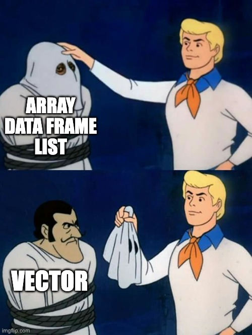

exclude: true
count: false

```{r,echo=FALSE,child="assets/header-slide.Rmd"}
```

<!-- ------------ Only edit title, subtitle & author above this ------------ -->

```{r,echo=FALSE,message=FALSE,warning=FALSE}
# load the packages you need
#library(dplyr)
#library(tidyr)
#library(stringr)
#library(ggplot2)
```

---
name: contents

## Contents

- Creating vectors
- Calculating with vectors
- Indexing: by position, name, condition
- Modifying, summarising, counting, sorting
- Generating vectors
- Factors

```{r, echo=FALSE, out.width="35%"}

```

---
name: atomic_vectors

## Vectors

A **vector** holds values of **one type**. Create it with `c()`:

```{r vector}
genes <- c("BRCA1", "TP53", "EGFR", "MYC", "GAPDH")
expression <- c(5.2, 7.8, 6.1, 9.4, 12.3)
length(expression)
```

A single value is a vector of length 1.

---
name: vec_arithmetic

## Calculating with vectors

Operations work on **every element**.

Read counts in four samples, normalized to **counts per million (CPM)**:

```{r vec.arithmetic}
counts   <- c(1520, 830, 2210, 1105)
lib_size <- c(20e6, 15e6, 25e6, 18e6)   # total reads per sample
cpm <- counts / lib_size * 1e6
cpm
log2(cpm + 1)
```

Same length → **element by element**: sample 1 with sample 1, and so on.

---
name: recycling_rule

## Recycling

Different lengths → the shorter vector is **repeated**:

```{r vec.recycling}
counts * 2                   # 2 is used for every element
c(1, 2, 3, 4) + c(0, 100)    # c(0, 100) becomes c(0, 100, 0, 100)
```

--

Lengths don't fit → **warning**:

```{r vec.recycling.warn, warning=TRUE}
c(1, 2, 3, 4, 5) + c(0, 100)
```

.content-box-yellow[
Recycling one number: useful. Anything else: usually a bug.
]

---
name: vec_indexing

## Indexing by position

`[ ]` picks elements. R counts from **1**.

```{r vec.indexing}
genes[2]           # second
genes[c(1, 3)]     # first and third
genes[2:4]         # second to fourth
genes[-5]          # all except the fifth
genes[10]          # beyond the end: NA
```

---
name: vec_indexing_names

## Indexing by name

```{r vec.names}
names(expression) <- genes
expression
expression["TP53"]
expression[c("MYC", "GAPDH")]
```

Names survive reordering. Positions don't.

---
name: vec_conditions

## Indexing by condition

Keep elements where the condition is `TRUE`:

```{r vec.cond}
expression > 7
expression[expression > 7]          # values
names(expression)[expression > 7]   # names
which(expression > 7)               # positions
```

This is **filtering**. You'll use it all the time.

---
name: vec_modify

## Modifying vectors

```{r vec.modify}
expr2 <- expression
expr2["MYC"] <- NA          # failed measurement
expr2[expr2 > 10] <- 10     # cap at 10
c(expr2, ACTB = 11.1)       # add an element
```

.footnote[Assigning past the end (`x[9] <- 1`) fills the gap with `NA`.]

---
name: vec_summaries

## Summarising

Ct values of five replicates:

```{r vec.summary}
ct <- c(24.1, 25.3, 23.8, 26.0, 24.7)
mean(ct)
sd(ct)
range(ct)
```

--

`NA` is contagious:

```{r vec.summary.na}
ct_missing <- c(24.1, 25.3, NA, 26.0)
mean(ct_missing)
mean(ct_missing, na.rm = TRUE)
```

---
name: vec_count

## Counting

Genotypes of 10 individuals at one SNP:

```{r vec.table}
genotype <- c("AA", "AG", "GG", "AG", "AA",
              "AG", "AA", "AA", "GG", "AG")
unique(genotype)
table(genotype)
table(genotype) / length(genotype)   # frequencies
```

---
name: vec_sorting

## Sorting

```{r vec.sort}
sort(expression)                     # lowest first
sort(expression, decreasing = TRUE)  # highest first
```

--

`order()` gives positions. Use it to sort one vector by another:

```{r vec.order}
genes[order(expression, decreasing = TRUE)]   # genes ranked by expression
```

.footnote[`sort()` drops `NA`s.]

---
name: seq

## Generating vectors

```{r seq}
1:6
seq(from = 0, to = 24, by = 6)           # time points (hours)
rep(c("control", "treated"), each = 3)   # group labels
paste0("S", 1:6)                         # sample names
paste(genes, collapse = ", ")            # many strings → one
```

---
name: random_sample

## Random sampling

Randomly assign six mice to groups:

```{r sample}
mice <- paste0("M", 1:6)
set.seed(42)     # same random result every time
sample(mice)     # first 3 treated, last 3 control
```

--

With replacement:

```{r sample.replace}
sample(c("AA", "AG", "GG"), size = 10, replace = TRUE)
```

---
name: factors

## Factors

Categories, such as groups. Possible values = **levels**.

```{r factor}
strain <- factor(c("WT", "KO", "WT", "KO", "KO", "WT"))
levels(strain)      # alphabetical: KO first
table(strain)
```

--

The first level is the **reference** (plots, models). Set it yourself:

```{r factor.levels}
strain <- factor(strain, levels = c("WT", "KO"))
levels(strain)
```

---
name: ordered_fac

## Ordered factors

For categories with a natural order:

```{r ordinal}
severity <- c("mild", "severe", "moderate", "mild", "severe")
severity <- factor(severity, levels = c("mild", "moderate", "severe"),
                   ordered = TRUE)
severity
severity > "mild"
```

---
name: recap

## Recap

| Task | Example |
|:-----|:--------|
| Create | `c(5.2, 7.8, 6.1)` |
| Calculate | `counts / lib_size * 1e6` |
| Index | `x[2]`, `x["TP53"]`, `x[x > 7]` |
| Modify | `x["MYC"] <- NA` |
| Summarise | `mean(x, na.rm = TRUE)`, `table(x)` |
| Sort | `sort(x)`, `genes[order(x)]` |
| Generate | `seq()`, `rep()`, `paste0()`, `sample()` |
| Categories | `factor(x, levels = ...)` |

<br>

**Remember:** one type per vector. Element by element. Short vectors get recycled.

<!-- --------------------- Do not edit this and below --------------------- -->

---
name: end_slide
class: end-slide, middle
count: false

# We will talk about matrices in the next lecture!

```{r,echo=FALSE,child="assets/footer-slide.Rmd"}
```

```{r,include=FALSE,eval=FALSE}
# manually run this to render this document to HTML
rmarkdown::render("presentation_demo.Rmd")
# manually run this to convert HTML to PDF
#pagedown::chrome_print("presentation_demo.html",output="presentation_demo.pdf")
```
