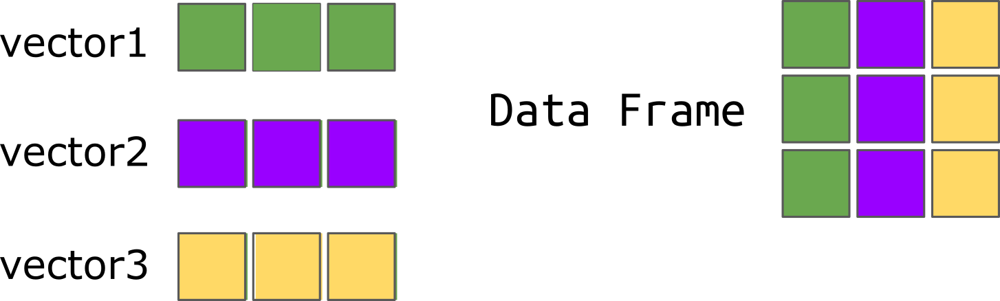
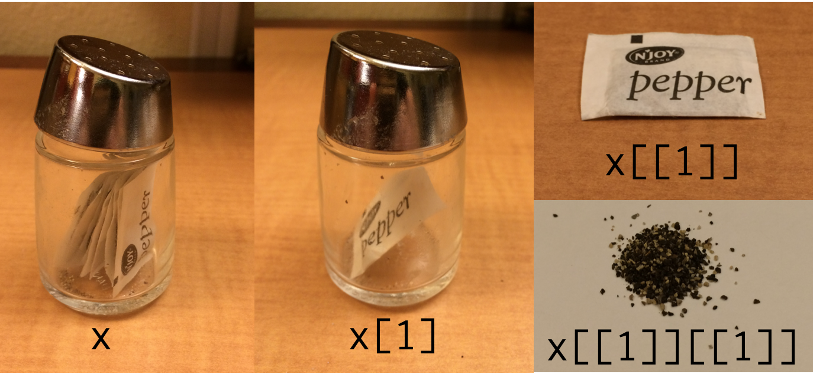

exclude: true
count: false

```{r,echo=FALSE,child="assets/header-slide.Rmd"}
```


```{r setup, include=FALSE}
knitr::opts_chunk$set(echo = FALSE)
```

---
name: puzzle

# Where would you store...

.pull-left-50[
### 1. A count table
20,000 genes × 6 samples.  
All numbers.

### 2. A sample sheet
ID, strain, sex, weight, treated?  
Text, numbers, `TRUE`/`FALSE`.

### 3. Your whole experiment
Both tables, the date, your notes, your plots.
]

--

.pull-right-50[
<br>

### A vector? ❌

One type. One dimension.

<br>

### We need bigger boxes 📦
]

---
name: containers

# Three containers

<br><br>

| | Container | Like a... | 
|:-:|:----------|:----------|
| 🧊 | **matrix** | ice-cube tray |
| 📋 | **data frame** | spreadsheet |
| 🎒 | **list** | backpack |


---
name: matrices

# 🧊 Matrices

Rows × columns, **one type**. A count table:

```{r matrix}
counts <- matrix(c( 120,  135,   40,   52,
                    300,  280,  310,  295,
                     15,   22,  180,  165,
                   2100, 1950, 2240, 2010),
                 nrow = 4, byrow = TRUE)
rownames(counts) <- c("BRCA1", "TP53", "MYC", "GAPDH")
colnames(counts) <- c("WT1", "WT2", "KO1", "KO2")
counts
dim(counts)
```

---
name: matrices_indexing

# Matrices: indexing

`[row, column]`. Leave one empty to get everything.

```{r matrix.ind}
counts["MYC", "KO1"]     # one value
counts["MYC", ]          # one gene, all samples
counts[, c("KO1", "KO2")]
```

--

Conditions work too:

```{r matrix.cond}
counts[counts[, "KO1"] > 100, ]   # genes with > 100 counts in KO1
```

---
name: matrices_calc

# Matrices: calculating

Operations work on every element:

```{r matrix.log}
log2(counts + 1)
```

--

Sums and means per row or column:

```{r matrix.sums}
colSums(counts)          # library size per sample
rowMeans(counts)         # mean per gene
apply(counts, 1, max)    # any function: 1 = rows, 2 = columns
```

---
name: matrices_combine

# Matrices: combining and flipping

```{r matrix.bind}
cbind(counts, KO3 = c(48, 305, 171, 2150))   # add a sample (column)
```

--

```{r matrix.t}
t(counts)    # transpose: samples become rows
```

---
name: data_frames_1

# 📋 Data frames

- A **table**: like a spreadsheet.
- Each column is a vector, with **its own type**.
- All columns have the **same length**.

<center>
.size-70[

]
</center>

---
name: data_frames_create

# Data frames: creating

A sample sheet. **Name your columns!**

```{r df.create}
samples <- data.frame(
  sample  = c("WT1", "WT2", "KO1", "KO2"),
  strain  = c("WT", "WT", "KO", "KO"),
  sex     = c("F", "M", "F", "M"),
  weight  = c(22.1, 25.4, 21.8, 26.3),
  treated = c(FALSE, TRUE, FALSE, TRUE)
)
samples
```

---
name: data_frames_inspect

# Data frames: a first look

```{r df.str}
str(samples)         # structure: columns and types
```

--

```{r df.summary}
summary(samples)
```

.footnote[Also useful: `head()`, `nrow()`, `ncol()`, `dim()`, `colnames()`.]

---
name: data_frames_accessing

# Data frames: accessing

`$` gets a column (a vector):

```{r df.dollar}
samples$weight
mean(samples$weight)
```

--

`[row, column]` works like a matrix:

```{r df.bracket}
samples[2, ]                          # second row
samples[, c("sample", "weight")]      # two columns
samples[3, "weight"]                  # one value
```

---
name: data_frames_filter

# Data frames: filtering rows

A condition picks the rows:

```{r df.filter}
samples[samples$strain == "KO", ]
samples[samples$strain == "KO" & samples$weight > 25, ]
samples$sample[samples$treated]       # just the names
```

This is your Excel filter. In one line, and it's saved in your script.

---
name: data_frames_add

# Data frames: adding columns

```{r df.add}
samples$heavy <- samples$weight > 24      # a new logical column
samples$strain <- factor(samples$strain, levels = c("WT", "KO"))
samples
```

--

Calculations on columns work on all rows at once, just like vectors.

---
name: data_frames_merging

# Data frames: merging

Another table, **in a different order**:

```{r df.merge1}
batches <- data.frame(sample = c("KO1", "WT1", "KO2", "WT2"),
                      batch  = c(1, 1, 2, 2))
```

--

`merge()` matches rows by a **key** column, not by position:

```{r df.merge2}
merge(samples[, c("sample", "strain")], batches, by = "sample")
```

.content-box-yellow[
Never paste tables side by side and hope the rows line up. Merge by ID.
]

---
name: data_frames_missing

# Data frames: missing values

```{r df.na}
samples$weight[2] <- NA      # a lost measurement
colSums(is.na(samples))      # NAs per column
na.omit(samples)             # drop rows with any NA
```

---
name: lists_1

# 🎒 Lists

A list holds **anything**: vectors, tables, other lists.

```{r lists}
experiment <- list(
  name    = "MYC knockout pilot",
  date    = "2026-03-14",
  samples = samples,
  counts  = counts
)
str(experiment, max.level = 1)
```

---
name: lists_subsetting

# Lists: `[[ ]]` vs `[ ]`

.pull-left-50[
```{r lists.double}
experiment[["name"]]
class(experiment[["name"]])
```

`[[ ]]` takes the thing **out**.
]

.pull-right-50[
```{r lists.single}
experiment["name"]
class(experiment["name"])
```

`[ ]` gives a **smaller list**.
]

<div style="clear: both;"></div>

```{r, echo=F, out.width="60%"}

```

---
name: lists_dollar

# Lists: `$` and digging deeper

`$` works like `[[ ]]` for named elements:

```{r lists.dollar}
experiment$name
experiment$samples$sample            # a column inside a data frame inside a list
experiment$counts["MYC", ]
```

--

Add or remove elements:

```{r lists.add}
experiment$notes <- "KO2 was sluggish on day 3"
experiment$date  <- NULL             # remove
names(experiment)
```

---
name: lists_results

# Lists are everywhere

Many functions return a list. A t-test, for example:

```{r ttest}
wt <- c(22.1, 25.4, 23.0, 24.2)
ko <- c(21.8, 26.3, 27.1, 26.0)
res <- t.test(ko, wt)
is.list(res)
names(res)
res$p.value
```

Knowing lists = knowing how to get your results out.

---
name: recap

# Recap

| | Shape | Types | Get things out |
|:--|:------|:------|:---------------|
| 🧊 **matrix** | rows × columns | one | `m["MYC", ]`, `m[, 2]` |
| 📋 **data frame** | rows × columns | one per column | `df$weight`, `df[df$x > 1, ]` |
| 🎒 **list** | anything | anything | `l$samples`, `l[["name"]]` |

<br>

**Remember:**

- Filter rows with conditions, not by hand.
- Merge tables by ID, not by position.
- `[[ ]]` takes out, `[ ]` keeps a list.

<!-- --------------------- Do not edit this and below --------------------- -->

---
name: end_slide
class: end-slide, middle
count: false

# See you at the next lecture!

```{r, echo=FALSE,child="assets/footer-slide.Rmd"}
```

```{r,include=FALSE,eval=FALSE}
# manually run this to render this document to HTML
#rmarkdown::render("presentation_demo.Rmd")
# manually run this to convert HTML to PDF
#pagedown::chrome_print("presentation_demo.html",output="presentation_demo.pdf")
```
