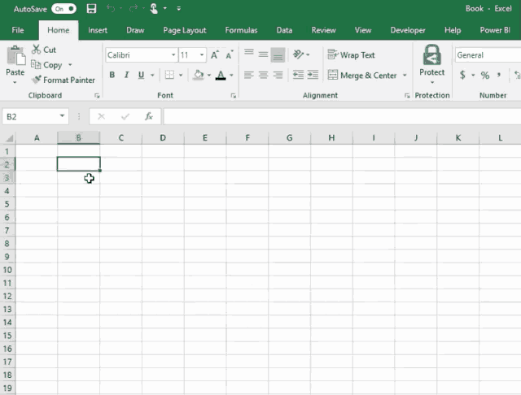
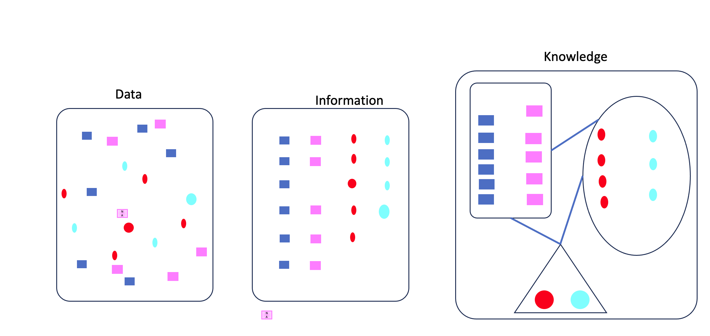
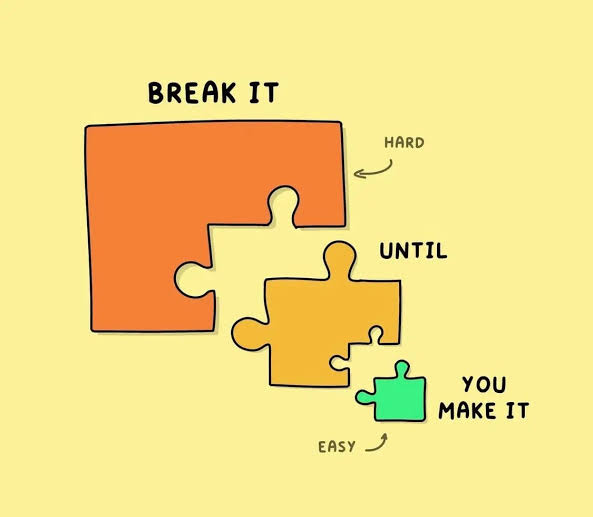
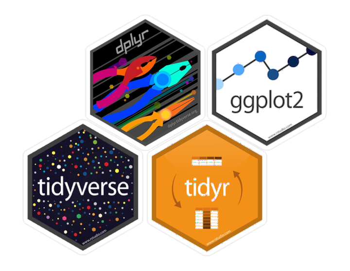
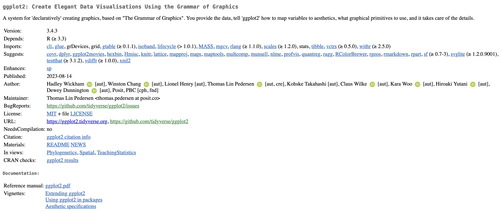
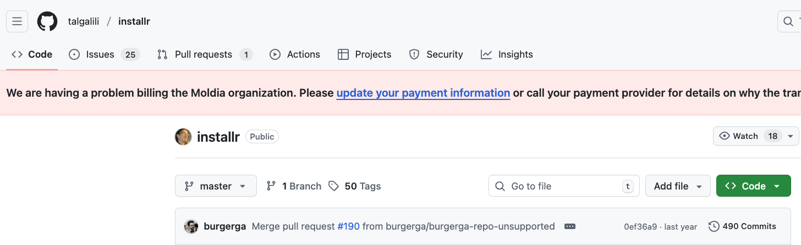

exclude: true
count: false

```{r,echo=FALSE,child="assets/header-slide.Rmd"}
```

```{r setup, include=FALSE}
# knitr::opts_chunk$set(echo = FALSE)
```

<!-- ------------ Only edit title, subtitle & author above this ------------ -->

```{r,echo=FALSE,message=FALSE,warning=FALSE}
# load the packages you need
#library(dplyr)
#library(tidyr)
#library(stringr)
library(ggplot2)
#library(mkteachr)
```

---
name: content
class: spaced

# Contents

1. [The problem: life in spreadsheets](#whyR) 🧨
2. [What R is (and isn't)](#about) 🧭
3. [How R compares](#compare) ⚖️
4. [Thinking like a programmer](#programming_language) 🧠
5. [Packages: standing on giants' shoulders](#packages) 📦
6. [R Markdown](#rmarkdown)
7. [Coding in the age of AI](#ai) 🤖


---
.pull-left-50[
Have you ever...

* lost track of which Excel file made a figure?
* redone an analysis by hand because data changed?
* had a gene name silently turned into a date?
* asked ChatGPT/Claude/Copilot to write code for you?
]

.pull-right-50[
<br>
### If you answered **yes** to any of these...

#### ...this course is for you.
]

---
name: whyR

# The GUI trap 🧨

* Manual copy-pasting across Excel files
* "Which version of `data_final_v3_REAL.xlsx` was this graph made from?"
* No record of *what you clicked*
* Silent gene name conversions (`SEPT9` $\rightarrow$ `Sept-09`, `MARCH1` $\rightarrow$ `1-Mar`)

<br></br>

```{r, echo=FALSE, out.width="35%", fig.align='center'}

```

--
<br></br>
Gene-name autocorrection errors were found in roughly **1 in 5** genomics papers with Excel supplements (Ziemann *et al.*, *Genome Biology*, 2016). The HGNC eventually **renamed the genes** to stop it.


---
name: about

# Briefly about R 🧭

.pull-left-50[
### R is ...

* a programming language **built for data & statistics**
* free, open-source, and runs everywhere
* driven by a core team **and** a huge community
* the home of cutting-edge statistics and bioinformatics
* a powerful computational tool in general
]

--

.pull-right-50[
### R is not ...

* the fastest language
* the most elegant language
* the best tool for *every* job (e.g. building games or phone apps)

]

---
name: compare

# How does R compare? ⚖️

```{r tool-comparison, echo=FALSE, fig.width=8.5, fig.height=4.8, fig.align='center', dpi=300}
tools_df <- data.frame(
  tool = c("Excel", "GraphPad\nPrism", "SPSS\n(GUI)", "Stata", "SAS", "R / Python"),
  flexibility = c(3.0, 2.0, 4.0, 7.0, 7.5, 9.5),
  reproducibility = c(2.0, 3.0, 3.5, 8.0, 8.5, 9.6),
  category = c("Spreadsheet", "GUI Tool", "GUI Tool", "Domain Scripting", "Domain Scripting", "Full Programming")
)

ggplot(tools_df, aes(x = flexibility, y = reproducibility, color = category)) +
  geom_point(size = 5) +
  geom_text(aes(label = tool), vjust = -0.8, fontface = "bold", size = 4.2, show.legend = FALSE) +
  scale_x_continuous(limits = c(1, 10.5), breaks = c(2, 5, 8, 10), labels = c("Low", "Medium", "High", "Unlimited")) +
  scale_y_continuous(limits = c(1, 10.5), breaks = c(2, 5, 8, 10), labels = c("Low", "Medium", "High", "Full")) +
  scale_color_manual(values = c(
    "Spreadsheet"      = "#e74c3c",
    "GUI Tool"         = "#e67e22",
    "Domain Scripting" = "#2980b9",
    "Full Programming" = "#27ae60"
  )) +
  labs(x = "Flexibility & Customization →", y = "Reproducibility →", color = NULL) +
  theme_minimal(base_size = 14) +
  theme(
    legend.position = "none",
    panel.grid.minor = element_blank(),
    axis.title = element_text(face = "bold"),
    plot.margin = margin(t = 20, r = 20, b = 10, l = 20)
  )
```


---
# Cost & licensing 💸

| Tool | Academic / Student | Commercial | Licensing Model |
| :--- | :---: | :---: | :--- |
| **R / Python** | **$0** | **$0** | **Open-source** |
| **MS Excel** | ~$100 / yr (M365) | ~$150 / yr | Subscription |
| **GraphPad Prism** | ~$140 – $260 / yr | ~$520 / yr | Per seat |
| **Stata** | ~$125 – $250 / yr | ~$1,000 – $3,700 / yr | Per user / core |
| **SPSS** | ~$100 – $300 / yr | ~$1,200 – $3,800 / yr | Per user / module |
| **SAS** | Free (OnDemand, limited) | $10,000s+ / yr | Enterprise |


<br>

* Your code keeps working when you **change jobs, institutions or countries**. 🔓
* Reviewers and collaborators can **re-run your analysis** without buying anything.

---
# R vs. Python 🐍

> **Python** is a general-purpose language that *can* do data analysis.  
> **R** was built *specifically* for data and statistics.

--
### Where R shines

* **Data wrangling:** the `tidyverse` (`dplyr`, `tidyr`) reads almost like English.
* **Plots:** `ggplot2` publication-quality figures with sensible defaults.
* **Statistics & biology:** new methods often appear in R/Bioconductor first.
* **Reporting:** **R Markdown**, **Quarto** and **Shiny** turn your code into reports, slides (like these!) and web apps.

--

.content-box-green[
**It's not a war.** The concepts you learn here (variables, functions, data frames, loops) transfer directly to Python.
]

---
name: demo
class: middle

# Three lines of R 🪄

```{r five-lines, fig.width=6, fig.height=3, dpi=200, fig.align='center'}
ggplot(iris, aes(x = Petal.Length, y = Petal.Width, colour = Species)) +
  geom_point(size = 2, alpha = 0.8) +
  geom_smooth(method = "lm", se = FALSE)
```

New data? Change **one word** (`iris`) and press **Run**. Try that in Excel.

---

# Why programming matters

Point-and-click is easy for **today**.  
`coding` is a superpower for **tomorrow**.

<div style="height: 40px;"></div>

```{r, echo=FALSE, fig.align='center', out.width="50%"}
knitr::include_graphics(path = "images/homer.jpg")
```

---
# Why programming matters

- **Self-documenting:** code records every step — no guessing how you got your results.
- **Instant re-runs:** new data? Press **Run** instead of remaking charts by hand.
- **Fewer silent errors:** no hidden formulas, shifted cells or forgotten menu clicks.
- **Scales effortlessly:** the same script handles 10 rows or 10 million.
- **Shareable:** a script is a recipe anyone can follow.

```{r,out.width="65%",fig.align='center',echo=FALSE}

```

---
name: programming_language

# Thinking like a programmer 🧠

Every programming language has three ingredients:

.pull-left-50[
1. **Data types** — *what* are we working with?
2. **Syntax** — *how* do we write it?
3. **Semantics** — what does it *mean*?
]

.pull-right-50[
Just like a natural language:

* words (nouns, numbers...)
* grammar
* meaning
]

---
# 1- Data types in R 🧱

.pull-left-50[
| Type | Example | `typeof()` |
| :--- | :--- | :--- |
| double | `3.14`, `-2` | `"double"` |
| integer | `5L` | `"integer"` |
| character | `"BRCA1"` | `"character"` |
| logical | `TRUE`, `FALSE` | `"logical"` |
| complex | `2+3i` | `"complex"` |

Missing values: `NA` (fits any type)
]


---
# 2 — Syntax: how do we write it?

The rules of the language's *grammar*.

--

The same calculation in two languages:

```
2 * 1 + 1        # R, Python, most languages
(+ (* 2 1) 1)    # Lisp
```

--

Break the grammar and the computer **refuses** to run:

```{r syntax-error, error=TRUE}
2 * (1 + 1
```

**Good news:** syntax errors are loud and easy to fix.

---
# 3 — Semantics: what does it *mean*?

Grammatically correct ≠ meaningful:

* *Colorful yellow sleeps on a crazy wave.* — no meaning
* *There is $500 on his empty bank account.* — internal contradiction

--

The same is true for code:

```{r semantics}
height <- 180   # cm
weight <- 70    # kg
bmi <- weight / height   # runs fine... but is it right?
bmi
```

--

.content-box-yellow[
BMI = weight (kg) / height (m)². R happily computed **nonsense**.  
**Semantic errors are silent.** Only *you* can catch them. Remember this when using AI!
]

---
name: topic2

# Where to start?
.pull-left-50[
```{r simple-chain-of-throught-fig, echo = F, eval = T}

```
]
--
<br></br>

*Decomposition* — divide and rule.

**Top-down approach:** define the big problem and split it into smaller ones. 

This is exactly how to work well with an AI assistant: break the problem into small, verifiable pieces.

---
name: packages

# Packages 📦

.pull-left-50[
* ready-made functions, data & documentation
* developed by the community
* cover very diverse areas of science
* uniformly structured and documented
* organised in repositories:
    + [CRAN](https://cran.r-project.org) — general purpose, 20,000+ packages
    + [Bioconductor](https://www.bioconductor.org) — bioinformatics, 2,000+ packages
    + [GitHub](https://github.com) — development versions
    + [R-universe](https://r-universe.dev) — browse it all
]

.pull-right-50[
```{r, out.width="220pt", fig.align='center', echo=FALSE}

```

```{r, out.width="220pt", fig.align='center', echo=FALSE}

```
]

---
name: CRAN

# Working with packages — a CRAN page

```{r,out.width="100%",fig.align='center',echo=FALSE}

```

**Tip:** the *Reference manual* and *Vignettes* are your best friends (and great context to give an AI assistant!).

---
name: pkg_cran_inst

# Installing packages

Only a few packages come pre-installed:

```{r pkg.err.ex,eval=TRUE,error=TRUE}
library(modelr)
```

Install **once** per computer:

```{r pkg.inst,eval=FALSE}
install.packages("ggplot2")
```

Load **every** session:

```{r pkg.load,eval=FALSE}
library(ggplot2)   # stops with an error if the package is missing
require(ggplot2)   # only warns, returns FALSE — handy inside functions
```

.footnote[Analogy: `install.packages()` = buying a book. `library()` = taking it off the shelf.]

---
name: work_pkg_details
exclude: true

# Installing packages — details

Choose a specific mirror (e.g. if your default one is down):

```{r pkg.inst.repo,eval=FALSE}
install.packages("ggplot2", repos = "https://cloud.r-project.org")
```

Sometimes no pre-built version exists for your platform, so you install from **source code**:

```{r pkg.inst.src,eval=FALSE}
install.packages("path/to/ggplot2_3.5.1.tar.gz",
                 repos = NULL,
                 type  = "source")
```

---
name: pkg_github

# Packages — GitHub

More and more developers share packages via GitHub. Use `remotes` (or `devtools`, which includes it):

```{r pkg.inst.github,eval=FALSE}
install.packages("remotes")
remotes::install_github("talgalili/installr")  # "username/repo"
```

.pull-center-50[
```{r, out.width="650pt", fig.align='center', echo=FALSE}

```
]

.footnote[⚠️ GitHub packages are not reviewed like CRAN/Bioconductor ones. Check who wrote it and whether it's maintained.]

---
name: pkg_bioconductor

# Packages — Bioconductor

```{r,out.width="200pt",fig.align='center',echo=FALSE}

```

First install the Bioconductor manager (once):

```{r inst.biocond,eval=FALSE}
if (!requireNamespace("BiocManager", quietly = TRUE))
    install.packages("BiocManager")
```

Then install Bioconductor packages:

```{r biocond.inst.pkg,eval=FALSE}
BiocManager::install("GenomicRanges")
```

For more info, visit the [Bioconductor website](https://www.bioconductor.org/install/).

---

# One tool to install them all: `pak` 🚀

`pak` installs from **CRAN, Bioconductor and GitHub** with one function — and it's fast.

```{r pak,eval=FALSE}
install.packages("pak")

pak::pak("ggplot2")              # CRAN
pak::pak("GenomicRanges")        # Bioconductor
pak::pak("talgalili/installr")   # GitHub
```


---
name: rmarkdown

# From R Markdown to report 📝

.pull-left-50[
**You write** (`report.Rmd`)

<pre style="font-size: 70%; line-height: 1.35;">
<span style="background:#d6eaf8;">&#45;&#45;&#45;
title: "Iris report"
&#45;&#45;&#45;</span>
&nbsp;
<span style="background:#e8daef;">&#35;&#35; Petal size</span>
&nbsp;
<span style="background:#d5f5e3;">&#96;&#96;&#96;{r}
ggplot(iris, aes(Petal.Length,
                 Petal.Width)) +
  geom_point()
&#96;&#96;&#96;</span>
&nbsp;
We measured <span style="background:#fdebd0;">&#96;r nrow(iris)&#96;</span> flowers.
</pre>
]

.pull-right-50[
**You get** (`report.html`)

### Iris report

#### Petal size

```{r rmd-demo-plot, echo=FALSE, fig.width=4, fig.height=2.4, dpi=150, out.width="100%"}
ggplot(iris, aes(Petal.Length, Petal.Width)) +
  geom_point() +
  theme_minimal(base_size = 11)
```

We measured `r nrow(iris)` flowers.
]

<div style="clear: both;"></div>

<span style="background:#d6eaf8;">&nbsp;**YAML header**&nbsp;</span> title & output format &nbsp;
<span style="background:#e8daef;">&nbsp;**Text**&nbsp;</span> headings, lists, links  
<span style="background:#d5f5e3;">&nbsp;**Code chunk**&nbsp;</span> runs, result inserted &nbsp;
<span style="background:#fdebd0;">&nbsp;**Inline code**&nbsp;</span> number in a sentence

---

# Why write reports in R Markdown?

**Code, text and results live in one file.** Press **Knit** to rebuild the whole report.

* **New data?** Knit again: every figure, table and number updates.
* **No copy-paste errors:** numbers in the text come straight from the code.
* **One file, many formats:** HTML, PDF, Word, slides (these slides are an `.Rmd` file!).
* **A reproducible record:** *"save the code, not the chat"*. The `.Rmd` is that record.

<br>

.content-box-green[
**Quarto** (`.qmd`) is the newer version of R Markdown. It works the same way, so what you learn today carries over.
]

👉 **In the lab** you will start your own *R learning journal* in R Markdown.
---

name: ai
class: middle, center

# Coding in the age of AI 🤖

### "If AI can write code, why should I learn R?"

---

# AI is a great assistant...

AI tools (ChatGPT, Claude, GitHub Copilot, Positron Assistant...) can:

* write a first draft of a script in seconds
* explain cryptic error messages
* translate code (Excel formula → R, Python → R)
* suggest packages and functions you didn't know about
* comment and document your code

--

There are even R packages to call language models **from R**, e.g. `ellmer` (from the Posit / tidyverse team).

--

.content-box-green[
Used well, AI makes learning R **faster**, not unnecessary.
]

---

# ...but you are still the scientist 🔬

.pull-left-50[
### AI can

* produce code that **runs**
* sound **very** confident
* write a lot, fast
]

.pull-right-50[
### AI can also

* invent functions or packages that **don't exist**
* use the **wrong statistical test**
* silently drop `NA`s, rows or samples
* be wrong in ways that *look* right
]


---
exclude: true
# Spot the bug 🕵️ (an "AI-generated" snippet)

> *Prompt: "Compare mean expression between treated and control samples."*

```{r spot-bug}
expr <- data.frame(
  sample = paste0("S", 1:6),
  group  = c("control", "control", "control", "treated", "treated", "treated"),
  value  = c(5.1, 4.8, NA, 7.9, 8.4, 8.1)
)

tapply(expr$value, expr$group, mean)
```

* Why is `control` `NA`? What should we do about the missing value?
* Is dropping it OK? Should we *report* it?
* With n = 3 per group, which test is appropriate — and why?

These are **scientific** decisions. AI can't make them for you.

---

# Working well with AI: a checklist ✅

1. **Understand first, then prompt.** Know roughly what the answer should look like.
2. **Ask for small pieces**, not a whole analysis (*divide et impera* again!).
3. **Read every line.** If you can't explain it, don't run it on real data.
4. **Test on tiny data** where you already know the answer.
5. **Check that functions & packages actually exist** (`?function_name`).
6. **Save the code, not the chat.** A script is reproducible; a conversation is not.
7. **Never paste sensitive data** (e.g. patient data) into public AI tools.

--

.content-box-green[
**AI writes the draft. You own the analysis.** That's why this course matters more now, not less.
]

---
# A suggestion:

- Try **not** to use AI agents
- Instead, use AI chatbots to:
  - fix syntax errors
  - learn more about concepts

---
name: recap
# Recap
* Why R?  
* About R.   
* R is a programming language for statistical computing and data analysis.  
* Packages and repositories.   
* Installing packages from CRAN, Bioconductor, GitHub.
* R Markdown: your research journal!
* AI and coding


<!-- --------------------- Do not edit this and below --------------------- -->

---
name: end_slide
class: end-slide, middle
count: false

# Thank you! Questions?
```{r, echo=FALSE,child="assets/footer-slide.Rmd"}
```

```{r,include=FALSE,eval=FALSE}
# manually run this to render this document to HTML
#rmarkdown::render("presentation_demo.Rmd")
# manually run this to convert HTML to PDF
#pagedown::chrome_print("presentation_demo.html",output="presentation_demo.pdf")
```
