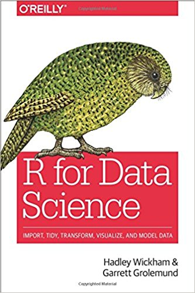
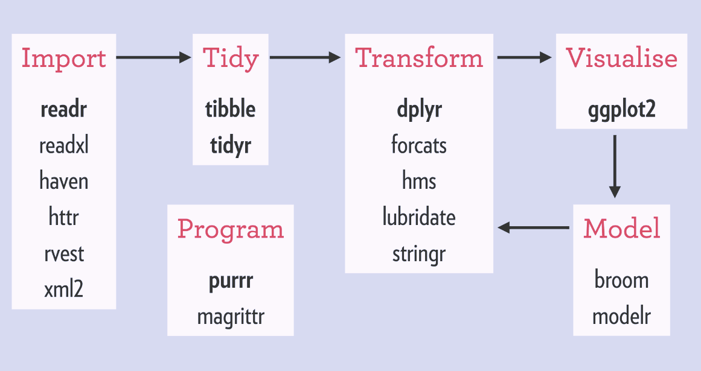
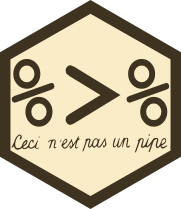
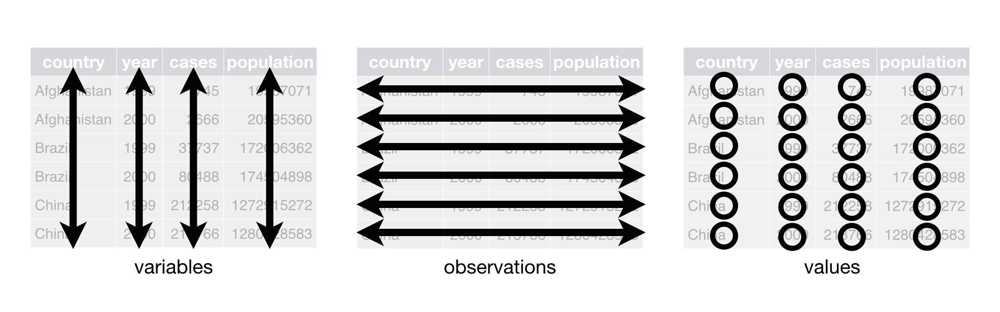

exclude: true
count: false

```{r,echo=FALSE,child="assets/header-slide.Rmd"}
```

<!-- ----------------- Only edit title & author above this ----------------- -->

```{r setup,include=FALSE}
knitr::opts_chunk$set(dev="png",results="hold",fig.show="hold",fig.align="left",echo=TRUE,warning=FALSE,message=FALSE)
options(crayon.enabled = FALSE)

# report related
library(knitr)
library(markdown)
library(rmarkdown)
```

```{r,echo=FALSE,message=FALSE,warning=FALSE}
# load the packages you need

library(tidyverse)
library(kableExtra)
library(magrittr)
```

---
name: learning_outcomes
# Learning Outcomes

<br>

Upon completing this module, you will:

* know what `tidyverse` is and a bit about its history

* be aware of useful packages within `tidyverse`

* be able to use basic pipes (including native R pipe)

* know whether the data you are working with are tidy

* be able to do basic tidying of your data

* be able to transform, group and summarise data with `dplyr`

* be able to join tables

---
name: tidyverse_overview
# Tidyverse -- What is it all About?

* [tidyverse](http://www.tidyverse.org) is a collection of &nbsp; 📦 📦
* created by [Hadley Wickham](http://hadley.nz)
* has become a *de facto* standard in data analyses
* a philosophy of programming or a **programming paradigm**: everything is about the &nbsp;🌊  &nbsp; flow of &nbsp; 🧹 &nbsp; tidy data

.center[



]
.vsmall[sources of images: www.tidyverse.org, Wikipedia, www.tidyverse.org]

---
name: tidyverse_curse
# ?(Tidyverse OR !Tidyverse)

> ☠️ &nbsp;There are still some people out there talking about the tidyverse curse though...&nbsp; ☠️<br>

--

> Navigating the balance between base R and the tidyverse is a challenge to learn.<br>[-Robert A. Muenchen](http://r4stats.com/articles/why-r-is-hard-to-learn/)

--

.center[]

.vsmall[source: http://www.storybench.org/getting-started-with-tidyverse-in-r/]

---
name: intro_to_pipes
# Pipes or Let my Data Flow &nbsp; 🌊

.pull-left-50[

.center[]

.vsmall[René Magritte, *La trahison des images*, [Wikimedia Commons](https://en.wikipedia.org/wiki/The_Treachery_of_Images#/media/File:MagrittePipe.jpg)]

.center[]
]

--

.pull-right-50[

* Let the data flow.
* *Ceci n'est pas une pipe* -- `magrittr`
* The `%>%` pipe:
  + `x %>% f` $\equiv$ `f(x)`
  + `x %>% f(y)` $\equiv$ `f(x, y)`
  + `x %>% f %>% g %>% h` $\equiv$ `h(g(f(x)))`

]

--

.pull-right-50[

instead of writing this:

```{r magrittr0, eval=F}
data <- iris
data <- head(data, n=3)
```

]

--

.pull-right-50[

write this:

```{r magrittr1}
iris %>% head(n=3)
```

]

---
name: native_r_pipe
# Native R Pipe

From R 4.1.0 there is a native pipe `|>`. It is simpler than `%>%`:

* `x |> f(y)` is rewritten to `f(x, y)` at parse time,
* the placeholder is `_` and it must be used with a **named** argument,
* no `.` placeholder, no `%T>%`, no `%$%` (those come from `magrittr`),
* anonymous function: `x |> (\(d) d[1:3, ])()`.

```{r native_pipe1}
c(1:5) |> mean()
mtcars |> lm(mpg ~ hp, data = _) |> coef()
```

```{r native_pipe2}
c(1:5) %>% mean()
mtcars %>% lm(mpg ~ hp, data = .) %>% coef()
```

> In this course we use `%>%`, because the lab needs `%T>%` and `%$%`. In new code `|>` is perfectly fine for the verbs below.


---
name: tibble_intro

# Tibbles

.pull-left-50[

.center[]
]

.pull-right-50[

* `tibble` is one of the unifying features of tidyverse,
* it is a *better* `data.frame` realization,
* objects `data.frame` can be coerced to `tibble` using `as_tibble()`
]

---
name: convert_to_tibble
# Convert `data.frame` to `tibble`
```{r}
as_tibble(iris)
```

---
name: tibble_from_scratch
# Tibbles from scratch with `tibble()`

```{r tibble_from_scratch, eval=FALSE}
tibble(
  x = 1,          # recycling
  y = runif(4),
  z = x + y^2,
  outcome = rnorm(4)
)
```

--

```{r tibble_from_scratch_eval, echo = F, eval=TRUE}
tibble(
  x = 1,          # recycling
  y = runif(4),
  z = x + y^2,
  outcome = rnorm(4)
)
```

---
name: more_on_tibbles
# More on Tibbles

* When you print a `tibble`:
  + all columns that fit the screen are shown,
  + first 10 rows are shown,
  + data type for each column is shown.

```{r tibble_printing}
as_tibble(cars)
```

---
name: tibble_printing_options
# Tibble Printing Options

* `my_tibble %>% print(n = 50, width = Inf)`,
* `options(tibble.print_min = 15, tibble.print_max = 25)`,
* `options(dplyr.print_min = Inf)`,
* `options(tibble.width = Inf)`

---
name: subsetting_tibbles
# Subsetting Tibbles

```{r tibble_subs}
vehicles <- as_tibble(cars[1:5,])
vehicles %>% print(n = 5)
```
  
  
--

We can subset tibbles in a number of ways:

```{r tibble_subs1}
vehicles[['speed']] # try also vehicles['speed']
vehicles[[1]]
vehicles$speed
```
  
  
--

> **Note!** Not all old R functions work with tibbles, then you have to use `as.data.frame(my_tibble)`.

---
name: tibbles_partial_matching

# Tibbles are Stricter than `data.frames`

```{r tibble_strict, warning=T, echo=F}
cars5 <- cars[1:5,]
```
```{r tibble_strict1, warning=T}
cars5$spe     # partial matching
```
```{r tibble_strict2, warning=T}
vehicles$spe  # no partial matching
```
```{r tibble_strict3, warning=T}
cars5$gear
```
```{r tibble_strict4, warning=T}
vehicles$gear
```

---
name: loading_data

# Loading Data

In `tidyverse` you import data using the `readr` package:

* `read_csv()` -- comma-delimited, `read_csv2()` -- semicolon-delimited,
* `read_tsv()` -- tab-delimited, `read_delim()` -- generic (any delimiter),
* `read_fwf()` -- fixed-width files.

--

Frequently used arguments:
* `skip` -- number of rows to skip,
* `col_names` -- a vector of column names (or `FALSE`),
* `col_types` -- force column types, e.g. `cols(id = col_character())`,
* `comment` -- character that designates a comment,
* `na` -- how missing values are represented.

`readr` tells you the column types it guessed. Check them!

Excel files: `readxl::read_excel()`.

---
name: readr_writing

# Writing to a File

The `readr` package also provides functions useful for writing tibbled data into a file:

* `write_csv()`
* `write_tsv()`
* `write_excel_csv()`

They **always** save:

* text in UTF-8,
* dates in ISO8601

But saving in csv (or tsv) does mean you lose information about the type of data in particular columns. You can avoid this by using:

* `write_rds()` and `read_rds()` to read/write objects in R binary rds format,
* `arrow::write_parquet()` and `arrow::read_parquet()` for a fast binary format that other programming languages can access.

---
name: basic_data_transformations

# Basic Data Transformations with `dplyr`

Let us create a tibble:

```{r}
set.seed(42)
bijou <- as_tibble(diamonds) %>% slice_sample(n = 200)
bijou %>% head(n = 5)
```

.center[  ]

---
name: filter

# Picking Observations using `filter()`

```{r}
bijou %>% filter(cut == 'Ideal' | cut == 'Premium', carat >= 0.23) %>% head(n = 4)
```
  

-- 

>⛵ &nbsp; Be careful with floating point comparisons! <br>
🏴‍☠️ &nbsp; Also, rows with comparison resulting in `NA` are skipped by default!

```{r, echo=T, eval=F}
bijou %>% filter(near(0.23, carat) | is.na(carat)) %>% head(n = 4)
```
  
---
name: arrange

# Rearranging Observations using `arrange()`

```{r, echo=T, eval=FALSE}
bijou %>% arrange(cut, carat, desc(price))
```
  
--

```{r, echo=FALSE, eval=TRUE}
bijou %>% arrange(cut, carat, desc(price))
```
  
--

>The `NA`s always end up at the end of the rearranged `tibble`!

---
name: select

# Selecting Variables with `select()`

Simple `select` with a range:

```{r}
bijou %>% select(color, clarity, x:z) %>% head(n = 4)
```

--

Exclusive `select`:
```{r}
bijou %>% select(-(x:z)) %>% head(n = 4)
```

---
name: rename
# Renaming Variables

>`rename()` changes column names and keeps all columns; `select(new = old)` renames but keeps only the selected columns.

```{r, eval=FALSE, echo=TRUE}
bijou %>% rename(var_x = x) %>% head(n = 5)
```
  
--

```{r, eval=T, echo=F}
bijou %>% rename(var_x = x) %>% head(n = 5)
```
  
---
name: bring_to_front
# Bring columns to front

>use `relocate()` (or `everything()` in `select`) to bring some columns to the front:

```{r, echo=TRUE, eval=FALSE}
bijou %>% relocate(x:z) %>% head(n = 4)   # same as select(x:z, everything())
```
  
--

```{r, echo=FALSE, eval=TRUE}
bijou %>% relocate(x:z) %>% head(n = 4)
```

---
name: mutate

# Create/alter new Variables with `mutate`

```{r, echo=T, eval=F}
bijou %>% mutate(p = x + z, q = p + y) %>% 
  select(-(depth:price)) %>% 
  head(n = 5)
```
  
  
--

```{r, echo=F, eval=T}
bijou %>% mutate(p = x + z, q = p + y) %>% 
  select(-(depth:price)) %>% 
  head(n = 5)
```

---
name: transmute
# Create/alter new Variables with `transmute` 🧙

>Only the transformed variables will be retained.

```{r}
bijou %>% transmute(carat, cut, sum = x + y + z) %>% head(n = 5)
```
  

---
name: grouped_summaries
# Group and Summarize

```{r}
bijou %>% group_by(cut) %>% summarize(max_price = max(price),
                                      mean_price = mean(price),
                                      min_price = min(price))
```
    

--

```{r}
bijou %>% group_by(cut, color) %>%
  summarize(max_price = max(price),
            mean_price = mean(price),
            min_price = min(price)) %>% head(n = 4)
```

---
name: other_data_manipulations

# Counting, Unique Rows and Slicing

```{r}
bijou %>% count(cut, sort = TRUE)
bijou %>% distinct(cut, color) %>% head(n = 3)
```

--

`slice_*()` replace the older `top_n()` and `sample_n()`:

```{r}
bijou %>% slice_max(price, n = 2)
bijou %>% group_by(cut) %>% slice_sample(n = 1)
```

---
name: grouping_notes

# Grouping Notes

* `summarise()` drops the last grouping level (the message about `.groups`).
* Use `ungroup()` when you need to regroup within the same pipe.
* Since `dplyr` 1.1 you can group for a single operation with `.by`:

```{r}
bijou %>% summarise(mean_price = mean(price), .by = cut)
```

---
name: across_case_when

# `across()` and `case_when()`

Apply the same function to many columns:

```{r}
bijou %>% summarise(across(c(carat, price), list(mean = mean, sd = sd)))
```

--

Create a variable from several conditions:

```{r}
bijou %>%
  mutate(size = case_when(carat < 0.5 ~ "small",
                          carat < 1   ~ "medium",
                          .default = "large")) %>%
  count(size)
```

---
name: concept_of_tidy_data

# The Concept of Tidy Data

Data are tidy *sensu Wickham* if:
* each and every observation is represented as exactly one row,
* each and every variable is represented by exactly one column,
* thus each data table cell contains only one value.

Usually data are untidy in only one way. However, if you are unlucky, they are really untidy and thus a pain to work with...

---
name: tidy_data

# Tidy Data



--

.center[**Are these data tidy?**]

.pull-left-70[
```{r tidy_iris1, echo=FALSE}
data("iris")
iris %>% head(n=3) %>% kable("html",escape=F,align="c") %>%
  kable_styling(bootstrap_options=c("striped","hover","responsive","condensed"),
                position="left",full_width = F)
```
]

--

.pull-right-30[

```{r tidy_iris2, echo=FALSE}
iris2 <- iris %>%
  pivot_longer(-Species, names_to = "variable", values_to = "value")
iris2 %>%
  head(n=3) %>%
  kable("html",escape=F,align="c") %>%
  kable_styling(bootstrap_options=c("striped","hover","responsive","condensed"),
                position="left",full_width = F)
```

]

<br>&nbsp;<hr><br>

--
.pull-left-50[

```{r tidy_iris3, echo=FALSE}
iris3 <-
  iris %>%
  unite(Sepal.L.W, Sepal.Length, Sepal.Width, sep = "/") %>%
  unite(Petal.L.W, Petal.Length, Petal.Width, sep = "/")
iris3 %>%
  head(n = 3) %>%
  kable("html",escape=F,align="c") %>%
  kable_styling(bootstrap_options=c("striped","hover","responsive","condensed"),
                position="left",full_width = F)
```

]

--

.pull-right-50[
```{r tidy_iris4, echo=FALSE}
iris4 <- t(iris)
iris4[,1:4] %>%
  kable("html",escape=F,align="c") %>%
  kable_styling(bootstrap_options=c("striped","hover","responsive","condensed"),
                position="left",full_width = F)
```

]

---
name: tidying_data_pivot_longer

# Tidying Data with `tidyr::pivot_longer`

If some of your column names are actually values of a variable, use `pivot_longer` (replaces `gather`):

```{r include=FALSE}
bijou %>%
  mutate(`2008` = price) %>%
  select(-price) %>%
  mutate(`2009` = `2008` + sample(rnorm(100, mean = 0.01 * mean(`2008`)),
                                size = 1,
                                replace=T
                                )
         ) %>%
  select(cut, `2008`, `2009`) -> bijou2
```
```{r bijou2}
bijou2 %>% head(n = 5)
```
```{r}
bijou2 %>%
  pivot_longer(c(`2008`, `2009`), names_to = 'year', values_to = 'price') %>%
  head(n = 5)
```

---
name: tidying_data_pivot_wider

# Tidying Data with `tidyr::pivot_wider`

If some of your observations are scattered across many rows, use `pivot_wider` (replaces `spread`):

```{r include=FALSE}
bijou %>% head(n = 3) %>% select(cut, price, clarity, x, y, z) %>% pivot_longer(c(x, y, z), names_to = 'dimension', values_to = 'measurement') -> bijou3
```

```{r bijou3}
bijou3
```

```{r}
bijou3 %>%
  pivot_wider(names_from=dimension, values_from=measurement) %>%
  head(n = 4)
```

---
name: tidying_data_separate

# Tidying Data with `separate`

If some of your columns contain more than one value, use `separate`:

```{r include=FALSE}
bijou %>% head(n = 5) %>% select(cut, price, clarity, x, y, z) %>% unite(dim, x, y, z, sep='/') -> bijou4
```
```{r bijou4}
bijou4
```
```{r}
bijou4 %>%
  separate(dim, into = c("x", "y", "z"), sep = "/", convert = T)
```

---
name: tidying_data_unite
# Tidying Data with `unite`

If one value is split across several columns, use `unite`:

```{r include=FALSE}
bijou %>% head(n = 5) %>% select(cut, price, clarity, x, y, z) %>% separate(clarity, into = c('clarity_prefix', 'clarity_suffix'), sep = 2) -> bijou5
```
```{r bijou5}
bijou5
```
```{r}
bijou5 %>% unite(clarity, clarity_prefix, clarity_suffix, sep='')
```

---
name: missing_complete

# Completing Missing Values Using `complete`

```{r eval=FALSE, include=FALSE}
bijou %>%
  head(n = 10) %>%
  select(cut, clarity, price) %>%
  mutate(cut, cut2=replace(cut, sample(1:10, 4, F), NA)) -> missing_stones
```
```{r}
bijou %>% head(n = 10) %>%
  select(cut, clarity, price) %>%
  mutate(continent = sample(c('AusOce', 'Eur'),
                            size = 10,
                            replace = T)) -> missing_stones
```
```{r}
missing_stones %>% complete(cut, continent)
```

---
name: joins

# Joining Data with `_join`

```{r echo=FALSE, eval=TRUE}
  tibble1 <- tibble(key = c(1, 2, 3, 4, 5), value1 = c('a', 'b', 'c', 'd', 'e'))
  tibble2 <- tibble(key = c(1, 2, 3, 6, 7), value2 = c('A', 'B', 'C', 'F', 'G'))
```

.pull-left-50[
```{r echo=FALSE}
print(tibble1)
```
]

.pull-right-50[
```{r echo=FALSE}
print(tibble2)
```
]

```{r}
inner_join(tibble1, tibble2, by = 'key')
```

---
name: joins2

# Mutating and Filtering Joins

* `inner_join()` -- rows with a match in both tables,
* `left_join()` / `right_join()` -- keep all rows of the left / right table (`NA` when no match),
* `full_join()` -- keep all rows of both,
* `anti_join()` -- rows of `x` with **no** match in `y`; `semi_join()` -- rows **with** a match.

```{r}
left_join(tibble1, tibble2, by = 'key')
anti_join(tibble1, tibble2, by = 'key')
```

Different key names: `by = c("id" = "key")` or `by = join_by(id == key)`.

---
name: more_tidyverse

# Some Other Friends

* `stringr` for string manipulation and regular expressions,
* `forcats` for working with factors,
* `lubridate` for working with dates,
* `purrr` for functional programming (`map()` and friends),
* `ggplot2` for graphics -- the next module!

---
name: end-slide
class: end-slide

# Thank you. Questions? [More?](https://r4ds.hadley.nz/)

```{r,echo=FALSE,child="assets/footer-slide.Rmd"}
```
